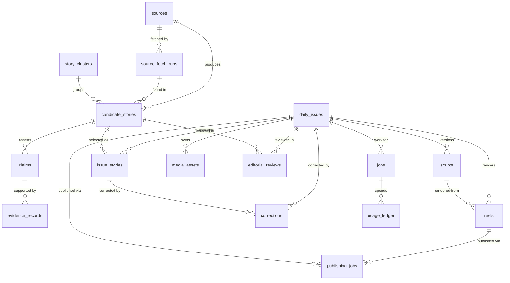

# Database Design — AI Daily Brief

Status: **Planning baseline v1** (2026-11-07). Target: PostgreSQL 15+ on Supabase ([ADR-002](TECHNICAL_DECISIONS.md#adr-002)).
Related: [SYSTEM_ARCHITECTURE §6 state machines](SYSTEM_ARCHITECTURE.md#6-state-machines) · [EDITORIAL_PIPELINE](EDITORIAL_PIPELINE.md) · [WORKFLOWS](WORKFLOWS.md)

## 1. Conventions

- **Keys:** surrogate keys are `bigint generated always as identity`. Natural business keys get a separate `unique` constraint (`source_key`, `canonical_url` hash, `issue_date`, `idempotency_key`).
- **Status fields:** `text` columns with `CHECK (status IN (...))` rather than Postgres `ENUM`s, because adding a state is a one-line migration and avoids `ALTER TYPE` limits. The allowed **transitions** are enforced in `brief/db/state.py`, and for `daily_issues` and `publishing_jobs` they are also enforced by a trigger.
- **Time:** every timestamp is `timestamptz` stored in UTC. Display uses `Asia/Kolkata`. `published_at` (when the source reported it), `event_at` (when it actually happened) and `collected_at` (when we fetched it) are always **separate columns**.
- **Hashes:** `sha256` hex strings in `char(64)` columns.
- **Text from sources:** we store only titles, short summaries (≤1,000 chars) and short verification excerpts (≤300 chars). Full source snapshots go to the **private** R2 bucket and are referenced by key, never published.
- **Access:** RLS is enabled on every table with no policies, so the anon and authenticated roles see nothing. The app connects as a dedicated `brief_app` role, and the PostgREST/Data API is not used for these tables. `audit_logs`, `corrections` and `editorial_reviews` are **append-only**: `UPDATE` and `DELETE` are revoked from `brief_app`.
- **Roles:** `brief_app` is used by the worker and CLI and has DML on app tables. `brief_n8n` is used by n8n and can only `EXECUTE` the `brief_*` SQL functions and `SELECT` the `v_*` views ([WORKFLOWS §1](WORKFLOWS.md#1-division-of-labour)). `brief_backup` is read-only and used for pg_dump. The Supabase `postgres`/service role is used only for migrations.
- **Migrations:** `migrations/NNNN_description.sql`, forward-only, applied by `brief db migrate` (records applied versions in `schema_migrations`). No ORM.

## 2. Scope: MVP vs later

| MVP (Phases 2–6) | Later (Phase 7+) | Deliberately not built |
|---|---|---|
| sources, source_fetch_runs, candidate_stories, story_clusters, claims, evidence_records, editorial_reviews, daily_issues, issue_stories, scripts, media_assets, reels, publishing_jobs, jobs, outbox_events, worker_heartbeats, corrections, audit_logs, usage_ledger, platform_tokens, schema_migrations | reel_metrics, site_metrics, email_deliveries, (newsletter_subscribers only if self-hosting email) | pgvector embeddings ([ADR-008](TECHNICAL_DECISIONS.md#adr-008)); user accounts; sponsor CRM tables (use a spreadsheet until Phase 8) |

**Phase 1 uses no database.** Editions live as `editions/YYYY-MM-DD.json`, validated by `schemas/edition.schema.json`. `brief issue import` loads them into these tables in Phase 2, which is why the JSON shape (§7) mirrors `daily_issues` + `issue_stories` + `claims` + `evidence_records`.

## 3. Entity-relationship overview



## 4. Tables

Abbreviations: **PK** primary key, **FK** foreign key, **UQ** unique, **IX** index. Every table also has `created_at timestamptz not null default now()`. Mutable tables additionally have an `updated_at` maintained by a trigger.

### 4.1 `sources` — registry of allowed sources
| Column | Type | Notes |
|---|---|---|
| id | bigint PK | |
| source_key | text UQ | slug, e.g. `anthropic-news` |
| name, publisher | text | |
| source_type | text CHECK | `rss`, `atom`, `github_releases`, `arxiv`, `html_page`, `apify` |
| tier | smallint CHECK 1..3 | 1 primary · 2 credible secondary · 3 discovery-only ([EDITORIAL_PIPELINE §2](EDITORIAL_PIPELINE.md)) |
| default_category | text CHECK | `model_release`, `research`, `open_source`, `business`, `policy`, `null` |
| base_url | text | |
| feed_url | text | partial UQ where not null |
| apify_actor_id | text | must be in `APIFY_ALLOWED_ACTORS` (app check) |
| apify_input | jsonb | fixed, bounded input (`maxItems` etc.) |
| fetch_interval_minutes | int default 60 | |
| enabled | bool default true | |
| etag, last_modified | text | conditional GET |
| last_success_at, last_error_at | timestamptz | |
| consecutive_failures | int default 0 | auto-disable at 10 + alert |
| notes | text | editorial trust notes |

IX: `(enabled, source_type)`. Retention: permanent. Sources are disabled, never deleted.

### 4.2 `source_fetch_runs` — one row per fetch attempt
| Column | Type | Notes |
|---|---|---|
| id | bigint PK | |
| source_id | FK → sources | |
| job_id | FK → jobs null | |
| started_at, finished_at | timestamptz | |
| status | text CHECK | `running`, `succeeded`, `not_modified`, `failed`, `skipped` |
| http_status | int | |
| items_seen, items_new, items_duplicate | int | |
| apify_run_id, apify_dataset_id | text | |
| cost_usd | numeric(10,4) | Apify run charge if any |
| error_class, error_message | text | message truncated to 1 kB, scrubbed |

IX: `(source_id, started_at desc)`. Retention: **90 days**.

### 4.3 `story_clusters` — one row per real-world development
| Column | Type | Notes |
|---|---|---|
| id | bigint PK | |
| cluster_key | text UQ | deterministic: sha256 of the representative's canonical URL at creation |
| label | text | short internal label |
| representative_story_id | FK → candidate_stories null | the best-sourced member (highest tier, then earliest) |
| primary_source_url | text | null until a tier-1 source is found |
| event_at | timestamptz null | best-known event time |
| first_seen_at, last_seen_at | timestamptz | |
| member_count | int | |
| last_covered_issue_id | FK → daily_issues null | duplicate-selection guard |
| last_covered_at | timestamptz null | |
| status | text CHECK | `open`, `covered`, `stale` |

IX: `(status, last_seen_at desc)`. Retention: permanent (small).

### 4.4 `candidate_stories` — normalised items from all sources
| Column | Type | Notes |
|---|---|---|
| id | bigint PK | |
| source_id | FK → sources | |
| fetch_run_id | FK → source_fetch_runs null | |
| canonical_url | text not null | normalised ([EDITORIAL_PIPELINE §3.2](EDITORIAL_PIPELINE.md)) |
| url_hash | char(64) **UQ** | sha256(canonical_url): the ingestion duplicate guard |
| original_url | text | as found |
| content_hash | char(64) | sha256(normalised title + summary); IX |
| title_original | text not null | |
| summary_original | text | ≤1,000 chars |
| snapshot_key | text | private R2 key of the fetched text |
| publisher, author | text | |
| source_tier | smallint | copied from source at ingest |
| category | text CHECK | as `sources.default_category`, plus `other` |
| companies, topics | text[] | normalised slugs; GIN IX |
| published_at | timestamptz | source-reported |
| event_at | timestamptz null | |
| event_at_basis | text CHECK | `stated`, `inferred`, `same_as_published`, `unknown` |
| collected_at | timestamptz not null | |
| cluster_id | FK → story_clusters null | |
| status | text CHECK | `candidate`, `duplicate`, `needs_evidence`, `verified`, `rejected`, `expired`, `selected`, `published`, `corrected` |
| rejection_reason | text | rule code, e.g. `R03_STALE_EVENT` |
| rule_results | jsonb | `{rule_code: pass/fail/na}` |
| score_total | numeric(5,2) | 0–100 |
| score_breakdown | jsonb | per criterion + `rule` vs `llm` vs `editor` origin |
| score_version | text | rubric version |

IX: `(status, collected_at desc)`, `(cluster_id)`, `(published_at desc)`, GIN trigram on `title_original` (`pg_trgm`). Retention: rows that were **never selected** are deleted after **180 days** and their snapshots after **30 days**. Selected or published rows are kept permanently.

### 4.5 `claims` — atomic statements used in published text
| Column | Type | Notes |
|---|---|---|
| id | bigint PK | |
| story_id | FK → candidate_stories | |
| claim_text | text not null | ≤400 chars |
| claim_type | text CHECK | `fact`, `vendor_claim`, `benchmark_vendor`, `benchmark_independent`, `availability`, `interpretation`, `forecast`, `quote` |
| materiality | text CHECK | `material`, `minor` |
| status | text CHECK | `unverified`, `supported`, `contested`, `unsupported`, `withdrawn` |
| confidence | text CHECK | `high`, `medium`, `low` |
| extracted_by | text CHECK | `llm`, `editor` |
| usage_id | FK → usage_ledger null | LLM call that proposed it |
| verified_by | text | |
| verified_at | timestamptz | |

IX: `(story_id)`. Rule (app + constraint trigger): `status='supported'` requires at least one `evidence_records` row with `stance='supports'` and `source_tier <= 2`. Retention: permanent for claims attached to published stories.

### 4.6 `evidence_records`
| Column | Type | Notes |
|---|---|---|
| id | bigint PK | |
| claim_id | FK → claims | |
| url | text not null | must be a URL that was **fetched** (never model-generated) |
| url_canonical | text | |
| source_id | FK → sources null | |
| publisher | text | |
| source_tier | smallint CHECK 1..3 | |
| stance | text CHECK | `supports`, `contradicts`, `context` |
| excerpt | text | ≤300 chars, verbatim, internal only |
| retrieved_at | timestamptz | |
| http_status | int | |
| snapshot_key | text | private R2 |
| checked_by | text | `auto` or editor id |

UQ: `(claim_id, url_canonical)`. Retention: permanent for published issues.

### 4.7 `editorial_reviews` — append-only decisions
| Column | Type | Notes |
|---|---|---|
| id | bigint PK | |
| issue_id | FK → daily_issues null | |
| story_id | FK → candidate_stories null | CHECK at least one of issue/story set |
| review_type | text CHECK | `shortlist_selection`, `story_verification`, `final_approval`, `correction_approval`, `sample_audit` |
| decision | text CHECK | `approved`, `rejected`, `changes_requested` |
| reviewer | text not null | |
| checklist | jsonb | the [six launch-review checks](EDITORIAL_PIPELINE.md#9-human-review) with booleans |
| notes | text | |

IX: `(issue_id, review_type, created_at desc)`. Retention: permanent.

### 4.8 `daily_issues`
| Column | Type | Notes |
|---|---|---|
| id | bigint PK | |
| issue_date | date **UQ** | one issue per day |
| issue_key | text **UQ** | `ADB-YYYY-MM-DD`; embedded in the caption, used for reconciliation |
| edition_number | int UQ null | assigned at go-live (`site_live`), sequentially; drives the "first 30 human-reviewed" rule (review is required while fewer than 30 earlier issues have gone live) |
| production_epoch | smallint not null default 1 | 1 = manual production, 2 = automated claims and script (Phase 3+). The full-review rule applies to the first 30 `site_live` issues **of each epoch** ([EDITORIAL_PIPELINE §9](EDITORIAL_PIPELINE.md#9-human-review)) |
| timezone | text default `Asia/Kolkata` | |
| cutoff_at | timestamptz | collection cutoff |
| status | text CHECK | see [state machine](SYSTEM_ARCHITECTURE.md#62-daily-issue-daily_issuesstatus) |
| is_quiet_day | bool default false | |
| skip_reason | text | |
| daily_thesis | text | one sentence |
| seo_title, seo_description | text | |
| caption | text | built from the record, ≤2,200 chars |
| hashtags | text[] | ≤5 |
| issue_url | text | |
| preview_url | text | Pages preview alias |
| site_deploy_id | text | Pages deployment id |
| approved_by | text, approved_at timestamptz | |
| site_live_at, published_at | timestamptz | |
| edition_json | jsonb | **frozen export at approval**; the site and the Reel are built from this |
| edition_json_hash | char(64) | |
| schema_version | text | edition schema version |

IX: `(status)`. Retention: permanent.

### 4.9 `issue_stories` — ordered stories in an issue, plus our original copy
| Column | Type | Notes |
|---|---|---|
| id | bigint PK | |
| issue_id | FK → daily_issues | |
| story_id | FK → candidate_stories | the cluster representative |
| rank | smallint CHECK 1..7 | |
| headline | text | our wording |
| summary | text | 2–4 sentences |
| why_it_matters | text | labelled analysis |
| technical_notes, limitations | text null | |
| category | text | |
| primary_source_url | text not null | |
| supporting_source_urls | text[] | |
| publisher | text | |
| published_at, event_at | timestamptz | copied, editable with audit |
| selected_reason | text | |
| editorial_score | numeric(5,2) | |
| card_text | text | ≤90 chars on screen |
| narration_text | text | |
| narration_duration_ms | int | measured |

UQ: `(issue_id, rank)`, `(issue_id, story_id)`. Retention: permanent.

### 4.10 `scripts`
| Column | Type | Notes |
|---|---|---|
| id | bigint PK | |
| issue_id | FK → daily_issues | |
| version | int | UQ `(issue_id, version)` |
| status | text CHECK | `draft`, `checked`, `approved`, `superseded` |
| hook_text, outro_text | text | |
| segments | jsonb | `[{issue_story_id, narration, on_screen_text}]` |
| full_text | text | |
| word_count | int, est_duration_s numeric | |
| checks | jsonb | automated check results ([EDITORIAL_PIPELINE §7](EDITORIAL_PIPELINE.md)) |
| prompt_version | text | |
| usage_id | FK → usage_ledger null | |
| created_by | text | `llm:<model>` or editor |

Partial UQ: `(issue_id) WHERE status = 'approved'`. Retention: permanent.

### 4.11 `media_assets`
| Column | Type | Notes |
|---|---|---|
| id | bigint PK | |
| issue_id | FK null | |
| asset_type | text CHECK | `narration_segment`, `card_image`, `subtitle_file`, `music`, `font`, `logo`, `reel_mp4`, `cover_image`, `source_snapshot`, `db_backup` |
| storage_bucket, storage_key | text | UQ `(storage_bucket, storage_key)` |
| public_url | text null | only for the `brief-public` bucket (covers and OG images after approval); MP4s are served to Meta by presigned URL, which is never stored |
| content_hash | char(64) | |
| cache_key | char(64) null | TTS: sha256(provider‖model‖voice‖settings‖text); partial UQ where not null |
| mime_type | text, bytes bigint | |
| duration_ms, width, height | int null | |
| provider, provider_model | text null | |
| license | text not null | `own`, `apache-2.0`, `licensed:<vendor>:<ref>`, … |
| license_note, source_url | text | provenance |
| retention_class | text CHECK | `permanent`, `90d`, `30d` |

Retention: `reel_mp4`, `cover_image` and `music`/`font`/`logo` are permanent. TTS segments are kept 90 days (the cache window). Card images and subtitle files are kept 30 days. Source snapshots are kept 30 days if unselected and permanently if used as evidence.

### 4.12 `reels`
| Column | Type | Notes |
|---|---|---|
| id | bigint PK | |
| issue_id | FK | |
| version | int | UQ `(issue_id, version)` |
| script_id | FK → scripts | |
| mp4_asset_id, cover_asset_id | FK → media_assets | |
| render_hash | char(64) | sha256 of the render manifest (script + asset hashes + template version); identical hash ⇒ skip re-render |
| duration_ms, width, height, fps | int | |
| video_codec, audio_codec | text | |
| validation | jsonb | ffprobe results and checks |
| status | text CHECK | `rendering`, `rendered`, `failed`, `approved`, `superseded` |
| render_seconds | numeric | |

Partial UQ: `(issue_id) WHERE status = 'approved'`.

### 4.13 `publishing_jobs` — the Instagram state machine
| Column | Type | Notes |
|---|---|---|
| id | bigint PK | |
| issue_id | FK | |
| reel_id | FK | |
| platform | text CHECK | `instagram` (later `youtube_shorts`, …) |
| idempotency_key | text **UQ** | `instagram:ADB-YYYY-MM-DD` |
| status | text CHECK | `pending`, `container_created`, `processing`, `ready`, `publishing`, `published`, `needs_reconciliation`, `failed`, `cancelled` |
| container_id | text | |
| container_status_code | text | `IN_PROGRESS`, `FINISHED`, `ERROR`, `EXPIRED`, `PUBLISHED` |
| container_created_at | timestamptz | containers expire after 24 h |
| media_id | text **UQ** null | |
| permalink | text | |
| caption_hash | char(64) | must equal the hash of the approved caption |
| attempts | int | |
| next_retry_at | timestamptz | |
| last_error_code, last_error_message | text | |
| api_version | text | Graph API version used |
| scheduled_for, published_at | timestamptz | |

**Partial UQ: `(issue_id, platform) WHERE status <> 'cancelled'`.** This is the main duplicate-publish guard. Retention: permanent.

### 4.14 `jobs` — work queue
| Column | Type | Notes |
|---|---|---|
| id | bigint PK | |
| job_type | text CHECK | see [WORKFLOWS §2](WORKFLOWS.md#2-job-types) |
| queue | text CHECK | `light`, `heavy` (heavy runs only on a worker with ffmpeg) |
| payload | jsonb | small; references by id |
| idempotency_key | text **UQ** | e.g. `render:ADB-2026-11-10:v2` |
| issue_id | FK null | |
| status | text CHECK | `queued`, `running`, `succeeded`, `failed_retryable`, `dead`, `cancelled` |
| priority | smallint default 100 | lower = sooner |
| run_after | timestamptz default now() | |
| attempts, max_attempts | int | default max 3; publish = 1 (never blind-retried) |
| locked_by | text, lease_expires_at timestamptz | lease renewed by heartbeat; expired leases are reclaimable |
| last_error | text | |
| result | jsonb | |
| finished_at | timestamptz | |

IX: `(queue, status, run_after, priority) WHERE status IN ('queued','failed_retryable')`. Retention: succeeded rows 30 days; `dead` rows 180 days.

### 4.15 `corrections` — append-only
| Column | Type | Notes |
|---|---|---|
| id | bigint PK | |
| issue_id | FK | |
| issue_story_id | FK null | |
| severity | text CHECK | `critical`, `material`, `minor` |
| original_text, corrected_text | text | |
| reason | text | |
| public_note | text | shown on the issue page (not for `minor`, which is logged only) |
| platform_action | text CHECK | `none`, `caption_edited`, `clarification_posted`, `reel_removed` |
| approved_by | text not null | |
| corrected_at | timestamptz | |

Retention: permanent.

### 4.16 `audit_logs` — append-only
| Column | Type | Notes |
|---|---|---|
| id | bigint PK | |
| occurred_at | timestamptz | |
| actor | text | `worker:<id>`, `n8n:<workflow>`, `editor:<name>`, `system` |
| entity_type, entity_id | text, bigint | |
| action | text | `status_change`, `api_call`, `deploy`, `approve`, … |
| from_status, to_status | text null | |
| details | jsonb | **scrubbed**; no tokens, no full prompts (prompt version + hash only) |
| job_id | FK null | |

IX: `(entity_type, entity_id, occurred_at)`. Retention: entries tied to issues and publishing are kept 2 years; ingest-noise entries 180 days.

### 4.17 `usage_ledger` — every paid call (LLM, TTS, Apify)
| Column | Type | Notes |
|---|---|---|
| id | bigint PK | |
| occurred_at | timestamptz | |
| provider | text | `anthropic`, `<fallback>`, `ollama` (local, cost 0), `tts:<vendor>`, `apify` |
| tier | text CHECK | `local`, `economy`, `standard`, `premium` (the LLM routing tier, [ADR-003](TECHNICAL_DECISIONS.md#adr-003)); null for non-LLM |
| batch | bool default false | true when sent through the Anthropic Message Batches API (billed at 50%) |
| operation | text | `tag_scope`, `same_event`, `triage`, `extract_claims`, `draft_script`, `critic`, `regression`, `tts_segment`, `actor_run` |
| model | text | exact model/voice id |
| prompt_version | text | |
| input_tokens, output_tokens, characters | int null | |
| cost_usd | numeric(10,5) | computed from the price table in config |
| job_id, issue_id | FK null | |
| request_id | text | provider request id |
| status | text | `ok`, `error`, `blocked_by_budget` |

IX: `(provider, occurred_at)`. Budget checks run `SUM(cost_usd)` for the current month before every call. Retention: 2 years (it is the cost record).

### 4.18 `platform_tokens`
`id`, `platform`, `account_id`, `token_ciphertext bytea` (pgcrypto `pgp_sym_encrypt`; the key lives only in the environment), `scopes text[]`, `issued_at`, `expires_at`, `refreshed_at`, `status` (`active`, `expiring`, `expired`, `revoked`). UQ `(platform, account_id)`.

### 4.19 `outbox_events` and `worker_heartbeats`
- **`outbox_events`** is the transactional outbox polled by n8n ([WORKFLOWS §1](WORKFLOWS.md#1-division-of-labour)). Columns: `id bigint PK`, `event_type text` (`shortlist_ready`, `issue_scripted`, `issue_rendered`, `review_ready`, `issue_site_live`, `reel_published`, `issue_held`, `job_dead`, `budget_warning`), `issue_id FK null`, `payload jsonb` (small and secret-free), `created_at`, `delivered_at timestamptz null`. IX: `(created_at) WHERE delivered_at IS NULL`. Rows are written **in the same transaction** as the state change that causes them. Retention: 30 days after delivery.
- **`worker_heartbeats`**: `worker_id text PK`, `queues text[]`, `version text` (git SHA), `capabilities jsonb` (`{"ffmpeg": "7.1", "wrangler": "…"}`), `last_seen_at timestamptz`. Updated every 60 s by `brief worker run`. Read by `v_watchdog`.

### 4.20 Later tables (Phase 7+)
- **`reel_metrics`**: `publishing_job_id` FK, `metric_window` (`24h`, `72h`, `7d`), `collected_at`, `views`, `reach`, `saves`, `shares`, `likes`, `comments`, `avg_watch_time_ms`, `raw jsonb`. UQ `(publishing_job_id, metric_window)`. Metric names must be checked against the current Insights API at implementation time.
- **`site_metrics`**: `issue_id`, `date`, `sessions`, `outbound_source_clicks`, `signup_clicks`. Aggregates only.
- **`email_deliveries`**: `issue_id`, `provider_campaign_id` UQ, `status`, `sent_at`, `recipients`, `opens`, `clicks`, aggregates only.
- **`newsletter_subscribers`**: **not created by default.** The email provider is the system of record for consent, double opt-in and unsubscribes ([ADR-010](TECHNICAL_DECISIONS.md#adr-010)), which keeps subscriber PII out of our database. Create it only if email is self-hosted later. Columns would be `email citext UQ`, `status`, `consent_text_version`, `consent_at`, `confirmed_at`, `unsubscribed_at`, and no IP storage.

## 5. Integrity rules enforced in SQL

1. `daily_issues` and `publishing_jobs` have a `BEFORE UPDATE OF status` trigger that rejects transitions not listed in `allowed_transitions(entity, from_status, to_status)`.
2. `claims.status = 'supported'` uses a constraint trigger: it requires an evidence row with `stance='supports' AND source_tier <= 2`.
3. `daily_issues.status` cannot become `approved` unless a `final_approval` review with `decision='approved'` exists for the issue. This is checked by trigger.
4. `daily_issues.status` cannot become `site_live` unless an `approved` reel exists and `edition_json_hash` is set.
5. `publishing_jobs.status` cannot become `publishing` unless the issue is `site_live` and `caption_hash` matches the hash of `daily_issues.caption`.
6. `issue_stories`: on approval, every story must have at least one `supported` material claim and no `unsupported` or `contested` material claim. This is checked in the app and by trigger on `in_review → approved`.

## 6. Duplicate prevention summary

| Duplicate risk | Guard |
|---|---|
| Same URL ingested twice | `candidate_stories.url_hash` UQ + `INSERT … ON CONFLICT DO NOTHING`; conditional GET with `etag`/`last_modified` |
| Same article under different URLs | `content_hash` lookup + trigram similarity → same `cluster_id`, status `duplicate` |
| Several outlets covering one event | `story_clusters`; only the representative is eligible for selection |
| Re-covering yesterday's story | `story_clusters.last_covered_at` within 7 days ⇒ hard rule `R07_RECENTLY_COVERED` unless the editor marks it "material update" (recorded in `editorial_reviews`) |
| Two issues for one day | `daily_issues.issue_date` UQ |
| Same job enqueued twice (n8n retry) | `jobs.idempotency_key` UQ, enqueue = `ON CONFLICT DO NOTHING` |
| Re-render with identical inputs | `reels.render_hash` lookup |
| Re-synthesising identical narration | `media_assets.cache_key` partial UQ |
| Two Reels for one issue | `publishing_jobs` partial UQ `(issue_id, platform)`, `idempotency_key` UQ, `media_id` UQ, `jobs.max_attempts = 1` for `publish_reel`, and reconciliation by `issue_key` in the caption before any retry ([WORKFLOWS WF-06](WORKFLOWS.md#wf-06-publish-reel)) |

## 7. Edition JSON (Phase 1 file format = `daily_issues.edition_json`)

`schemas/edition.schema.json` is generated from `brief/edition/schema.py`. The shape is illustrative and normative for Phase 1:

```json
{
  "schema_version": "1.0",
  "issue_key": "ADB-2026-11-20",
  "issue_date": "2026-11-20",
  "timezone": "Asia/Kolkata",
  "cutoff_at": "2026-11-20T11:30:00Z",
  "status": "draft",
  "is_quiet_day": false,
  "daily_thesis": "One sentence, grounded in the selected stories.",
  "seo": { "title": "…", "description": "…" },
  "stories": [
    {
      "story_id": "anthropic-news:2026-11-20:example-slug",
      "rank": 1,
      "category": "model_release",
      "headline": "Our original headline",
      "summary": "Two to four sentences, grounded in evidence.",
      "why_it_matters": "Labelled analysis, separate from fact.",
      "technical_notes": null,
      "limitations": "Vendor-reported benchmarks; no independent evaluation yet.",
      "publisher": "Example Lab",
      "source_type": "rss",
      "source_tier": 1,
      "collected_at": "2026-11-20T09:20:00Z",
      "primary_source_url": "https://…",
      "supporting_source_urls": [],
      "published_at": "2026-11-20T09:00:00Z",
      "event_at": "2026-11-20T09:00:00Z",
      "event_at_basis": "stated",
      "selected_reason": "…",
      "score": { "total": 82, "significance": 22, "source_confidence": 25, "freshness": 18, "practical_relevance": 9, "novelty": 6, "audience_fit": 2 },
      "claims": [
        {
          "claim_text": "…",
          "claim_type": "vendor_claim",
          "materiality": "material",
          "status": "supported",
          "verified_by": "editor",
          "verified_at": "2026-11-20T11:50:00Z",
          "evidence": [
            { "url": "https://…", "publisher": "…", "source_tier": 1, "stance": "supports", "excerpt": "…", "retrieved_at": "…" }
          ]
        }
      ],
      "card_text": "≤90 chars",
      "narration": "Spoken text for this segment."
    }
  ],
  "script": { "hook": "…", "outro": "Full stories and original links: link in bio.", "version": 1 },
  "caption": "Built from the same record…",
  "hashtags": ["#AI"],
  "issue_url": "https://<domain>/issues/2026-11-20/",
  "production_epoch": 1,
  "review": { "regime": "full", "regime_reason": "manual edition 3 of 30", "reviewer": "…", "decision": "approved", "checklist": {}, "reviewed_at": "…" },
  "corrections": [],
  "media": { "narration": [{ "segment": 1, "file": "…", "sha256": "…", "tts_provider": "…", "tts_model": "…", "voice": "…" }], "mp4": { "key": "…", "sha256": "…" }, "cover": { "key": "…" } },
  "deployment": { "preview_url": "…", "production_deploy_id": "…", "deployed_at": "…", "linkcheck": "pass" },
  "publication": { "platform": "instagram", "method": "manual", "permalink": null, "media_id": null, "published_at": null },
  "production_log": { "minutes_research": 0, "minutes_verify": 0, "minutes_script": 0, "minutes_render": 0, "minutes_publish": 0 }
}
```

`production_log` exists only in Phase 1 and the soft launch. From Phase 2 onward, durations come from `audit_logs` and `jobs`. Every field required by the [mandatory audit trail](EDITORIAL_PIPELINE.md#14-mandatory-editorial-audit-trail) is present here, and its absence fails C01.

## 8. Migration outline (`migrations/0001_init.sql`, abridged)

```sql
create extension if not exists pg_trgm;
create extension if not exists pgcrypto;
create extension if not exists citext;

create table schema_migrations (version text primary key, applied_at timestamptz not null default now());

create table sources (
  id bigint generated always as identity primary key,
  source_key text not null unique,
  name text not null,
  publisher text not null,
  source_type text not null check (source_type in ('rss','atom','github_releases','arxiv','html_page','apify')),
  tier smallint not null check (tier between 1 and 3),
  default_category text check (default_category in ('model_release','research','open_source','business','policy')),
  base_url text not null,
  feed_url text,
  apify_actor_id text,
  apify_input jsonb,
  fetch_interval_minutes int not null default 60 check (fetch_interval_minutes >= 15),
  enabled boolean not null default true,
  etag text, last_modified text,
  last_success_at timestamptz, last_error_at timestamptz,
  consecutive_failures int not null default 0,
  notes text,
  created_at timestamptz not null default now(),
  updated_at timestamptz not null default now()
);
create unique index sources_feed_url_uq on sources(feed_url) where feed_url is not null;

create table jobs (
  id bigint generated always as identity primary key,
  job_type text not null,
  queue text not null default 'light' check (queue in ('light','heavy')),
  payload jsonb not null default '{}',
  idempotency_key text not null unique,
  issue_id bigint,
  status text not null default 'queued'
    check (status in ('queued','running','succeeded','failed_retryable','dead','cancelled')),
  priority smallint not null default 100,
  run_after timestamptz not null default now(),
  attempts int not null default 0,
  max_attempts int not null default 3,
  locked_by text, lease_expires_at timestamptz,
  last_error text, result jsonb,
  created_at timestamptz not null default now(),
  finished_at timestamptz
);
create index jobs_ready_ix on jobs(queue, status, run_after, priority)
  where status in ('queued','failed_retryable');

-- source_fetch_runs, story_clusters, candidate_stories, claims, evidence_records,
-- daily_issues, issue_stories, editorial_reviews, scripts, media_assets, reels,
-- publishing_jobs, corrections, audit_logs, usage_ledger, platform_tokens
-- follow §4 exactly (one CREATE TABLE each, constraints inline).

create unique index candidate_stories_url_hash_uq on candidate_stories(url_hash);
create index candidate_stories_title_trgm on candidate_stories using gin (title_original gin_trgm_ops);
create unique index publishing_jobs_issue_platform_uq on publishing_jobs(issue_id, platform)
  where status <> 'cancelled';
create unique index scripts_one_approved on scripts(issue_id) where status = 'approved';
create unique index reels_one_approved on reels(issue_id) where status = 'approved';
create unique index media_assets_cache_key_uq on media_assets(cache_key) where cache_key is not null;

-- Job claim (used by brief/jobs/queue.py)
-- update jobs set status='running', locked_by=$1, lease_expires_at=now()+interval '10 minutes',
--        attempts=attempts+1
--  where id = (select id from jobs
--               where queue = any($2) and status in ('queued','failed_retryable') and run_after <= now()
--               order by priority, run_after
--               for update skip locked limit 1)
--  returning *;

-- Append-only enforcement
revoke update, delete on audit_logs, corrections, editorial_reviews from brief_app;

-- RLS: enable on every table, no policies (service role / brief_app bypass via ownership grants)
alter table sources enable row level security;
-- … repeat for each table
```

## 9. Retention summary

| Data | Retention | Mechanism |
|---|---|---|
| Published issues, issue_stories, claims, evidence, corrections, reviews, publishing_jobs | Permanent | — |
| Final MP4 (private R2) + cover (public R2) | Permanent (~30 MB each ⇒ ~1 GB/month) | Re-evaluate when R2 passes ~8 GB |
| Unselected candidate_stories | 180 days | nightly `brief maintenance prune` |
| Source snapshots (private R2) | 30 days unless they are evidence | R2 lifecycle rule on prefix `snapshots/unlinked/`; evidence snapshots move to `snapshots/evidence/` |
| TTS segments, cards, subtitles | 90 / 30 / 30 days | R2 lifecycle by prefix |
| jobs (succeeded) / (dead) | 30 / 180 days | prune job |
| source_fetch_runs | 90 days | prune job |
| audit_logs | 2 years (issue/publish), 180 days (ingest) | prune job |
| usage_ledger | 2 years | — |
| DB backups | 30 daily + 12 monthly | R2 lifecycle on `backups/` |
