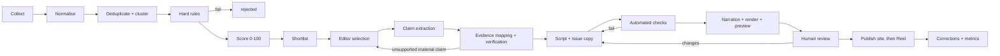

# Editorial Pipeline — AI Daily Brief

Status: **Planning baseline v1** (2026-11-07). Source: business plan §3, §6, §11 and Appendix B, revised where noted.
Related: [DATABASE_DESIGN](DATABASE_DESIGN.md) · [WORKFLOWS](WORKFLOWS.md) · [RISKS_AND_OPERATIONS](RISKS_AND_OPERATIONS.md)

> The product is trustworthy editorial judgement. Automation supports that judgement and never replaces it.
> "Daily" refers to the daily editorial process. It is not a quota of stories to fill.

## 1. Pipeline overview

| Step | Who / what | Phase built | Output |
|---|---|---|---|
| Collect | `brief ingest` (feeds, GitHub, arXiv, Apify) | 2 (manual in Phase 1) | `candidate_stories` |
| Normalise | rules in code | 2 | canonical URL, dates, category |
| Cluster | rules + trigram, optional LLM adjudication | 2 | `story_clusters` |
| Hard rules | code ([§6](#6-hard-rejection-rules)) | 3 | `rule_results`, rejections |
| Score | rules + LLM-proposed sub-scores | 3 | `score_breakdown` |
| Select | **editor** (n8n form) | 3 | `editorial_reviews: shortlist_selection` |
| Claims + evidence | LLM proposes, code checks, **editor confirms** | 3 | `claims`, `evidence_records` |
| Script + copy | LLM drafts from verified claims only | 1 (assisted), 3 | `scripts`, `issue_stories` copy |
| Automated checks | code ([§7.3](#73-automated-checks)) | 1–3 | `scripts.checks` |
| Review | **editor** | 1 onward | `editorial_reviews: final_approval` |

## 2. Source hierarchy and initial allow-list

| Tier | Definition | Can establish a claim? | Examples |
|---|---|---|---|
| **1 Primary** | Original announcement, paper, official docs or changelog, repository release, regulatory text, dataset | **Yes** | Company newsrooms and blogs, arXiv/journal pages, GitHub releases, government and regulator sites |
| **2 Credible secondary** | Established publication with named attribution, corroboration or original reporting | **Yes, with attribution** ("according to Reuters"); must be corroborated if contentious or high-impact | Reuters, Bloomberg, The Verge, Ars Technica, TechCrunch, MIT Technology Review |
| **3 Discovery-only** | Social posts, forums, aggregators, community discussion, search snippets | **Never.** Only used to find leads | Hacker News, Reddit, X/Bluesky posts, Techmeme, newsletters |

**Initial allow-list candidates (P1-01 confirms ~20).** These are names only. Feed URLs, terms and robots rules must be checked one by one in P1-01. None is assumed.

- Tier 1 labs and companies: OpenAI News, Anthropic News, Google DeepMind Blog, Google Research/AI blog, Meta AI Blog, Microsoft Research / AI blog, NVIDIA technical blog, Mistral AI news, Hugging Face blog, Amazon Science / AWS ML blog, Apple Machine Learning Research.
- Tier 1 research: arXiv listings for cs.AI, cs.CL, cs.LG and cs.CV (high volume, so filtered by keyword and affiliation and capped per day).
- Tier 1 open source: GitHub releases for a curated repo list (e.g. transformers, vLLM, llama.cpp, Ollama, PyTorch). The list lives in `sources` and is reviewed monthly.
- Tier 1 policy: EU AI Office, US NIST AI, UK AI Security Institute, India MeitY / IndiaAI Mission.
- Tier 2: 4–6 publications chosen in P1-01, favouring those with working RSS and non-paywalled summaries.
- Tier 3: Hacker News front page (API), selected subreddits. They are used **only** to create `needs_evidence` leads.

**Collection order of preference:** official RSS/Atom → official API (GitHub, arXiv) → simple HTML fetch of a page we're permitted to read → an Apify Actor (allow-listed, bounded). Login-walled or anti-bot-protected content is never collected, and access controls are never bypassed.

## 3. Normalisation

### 3.1 Category
The category is one of `model_release`, `research`, `open_source`, `business` or `policy`. The source default is applied first, then keyword rules, and the LLM triage hint can propose a change that the editor confirms. A story has exactly one category.

### 3.2 Canonical URL (`brief/ingest/canonical_url.py`)
1. Use `https` only and reject other schemes. Lowercase the host, drop default ports and drop fragments.
2. Remove tracking parameters: `utm_*`, `fbclid`, `gclid`, `mc_cid`, `mc_eid`, `ref`, `ref_src`, `source`, `igshid`, `si`. Keep all other parameters, sorted.
3. Resolve redirects with HEAD, then GET on 405, up to 5 hops, and keep the final URL.
4. If the page declares `<link rel="canonical">` on the **same registrable domain**, use it.
5. Special forms: arXiv becomes `https://arxiv.org/abs/<id>` with the version stored separately. GitHub releases become `https://github.com/<owner>/<repo>/releases/tag/<tag>`.
6. `url_hash = sha256(canonical_url)`.

### 3.3 Dates
| Field | Rule |
|---|---|
| `published_at` | From the feed or API. If it is missing, use page metadata (`article:published_time`, JSON-LD). If that is also missing, use `null` and the story cannot score freshness above 8 |
| `event_at` | Tier-1 announcement: equals its `published_at` (`same_as_published`). Secondary article: equals the linked primary's `published_at` once found (`stated`). arXiv: the v1 submission date, with later versions noted. GitHub: the release `published_at`. The LLM may propose an event date **only when it quotes the date string from the text** (`inferred`); the editor confirms it |
| `collected_at` | Our fetch time; never edited |

## 4. Deduplication and clustering (`brief/intel/cluster.py`)

The steps below run in order. The first match assigns the cluster:
1. **Same `url_hash`:** dropped at insert (`ON CONFLICT DO NOTHING`).
2. **Same `content_hash`:** marked `duplicate` in the existing cluster.
3. **Shared primary link:** the secondary article links to a tier-1 URL that is already in a cluster, so it joins that cluster. Outbound links are extracted at ingest and only tier-1 domains are kept.
4. **Similar title and entity:** trigram similarity ≥ 0.60, a shared company or product slug, and both items within 72 h. They join the same cluster.
5. **Borderline pairs** (similarity 0.45–0.60 with a shared entity): an optional LLM call answers "same real-world event? yes/no/unsure" as structured output, capped at 20 calls per day. If the answer is `unsure`, the items stay separate and the editor sees both.

**Representative choice:** the highest tier (tier 1 first), then the earliest `published_at`, then the most complete metadata. Only cluster representatives can be selected.

**Recently covered check:** if `story_clusters.last_covered_at` is within 7 days, rule `R07` applies (§6). Thresholds are config values and get tuned against Phase 1 data (P2-08).

## 5. Ranking — the 100-point rubric (`brief/intel/score.py`, `score_version = "1.1"`)

**Rubric v1.1 is finalised for Day 1** (G1 readiness item M7). v1.1 differs from v1.0 only in how freshness is measured (§5.2, PD-06, approved 2026-11-07). For a daily edition it gives exactly the same scores as v1.0.

Each sub-score records where it came from: `rule` (computed in code), `llm` (proposed by the model with a one-line rationale), or `editor` (an override, which is logged). **Hard rules (§6) are applied before scoring and override any score.**

| Criterion | Max | Origin | Anchors |
|---|---:|---|---|
| Significance | 25 | llm → editor | 21–25: changes capability, availability, cost, safety or regulation for many users. 11–20: notable for a segment. 0–10: incremental |
| Source confidence | 25 | **rule** | 25: tier-1 source with the material claims supported. 18: tier-2 attributed and corroborated. 10: tier-2 single source. 0: tier-3 only (the item is also blocked by R01) |
| Freshness | 20 | **rule** | Measured against the **edition window** (§5.2), using `event_at`, the real-world event time, **not** the article's `published_at`. Event inside the edition window: 20; up to 24 h before the window opened: 14; 24–48 h before: 8; older: 0. If `event_at` is unknown, the score is capped at 8 and the item is flagged for the editor to confirm the date |
| Practical relevance | 15 | llm → editor | Can builders, students or pros use or act on this now? (available, documented, priced) |
| Novelty | 10 | rule + llm | Rule part (0–5): 5 if the cluster has not been covered in 30 days, 2 if it has but there is a material update, 0 otherwise. LLM part (0–5): new information versus the last coverage summary |
| Audience fit | 5 | llm | Within AI scope and useful to the target audience |

### 5.1 Selection policy
- **Eligibility:** status `verified`, all hard rules pass, and `score_total ≥ 55`. The threshold is **fixed for the 14-day experiment**, because H1 depends on it. It may be tuned only after the Phase 1 gate, and any change bumps `score_version`.
- **Target is 5–7 stories, and fewer is acceptable.** Candidates are ranked by score. Category weights (30/25/20/15/10) act only as a **tie-breaker within 5 points**, never as a quota.
- **Quiet day:** with fewer than 3 eligible stories, the editor chooses between a short Reel (2–3 stories, ≥35 s) labelled "Quiet day", a web-only issue, or skipping the day. Filler is never added.
- **Lead story:** the highest score, unless the editor overrides with a recorded reason.

### 5.2 Edition window and weekend stories (rubric v1.1, PD-06)
- **Edition window:** the time from the previous **published** edition's cutoff to this edition's cutoff.
  - Tuesday–Friday: 24 h.
  - **Monday: Friday 17:00 → Monday 17:00 (72 h).** Saturday and Sunday developments fall inside the window.
  - After a skipped day: back to the last published edition's cutoff.
- **Monday's edition may include important Saturday and Sunday developments.** They score on event date, publication date, freshness, significance and relevance like any other story. An important weekend event **gets full freshness (20)**. It is **not penalised because it happened or was published earlier** than Monday.
- **Event date ≠ publication date:**
  - Freshness uses `event_at`.
  - `published_at` is recorded and shown separately in the approval report and on the issue page, as "Event: Sat 22 Nov · Published: Sun 23 Nov".
  - An old event in a new article is still rejected by R03; the weekend rule never turns old news into new news.
- **Wording:** weekend stories must use the day, not "today" (for example "On Saturday, …"). Check C06/R12 enforces this.
- **Daily cadence (the experiment):** the window is 24 h, so v1.1 scores are identical to v1.0. The pre-registered experiment is unaffected.

## 6. Hard rejection rules

Implemented in `brief/intel/rules.py`.

| Code | Rule | Applies at |
|---|---|---|
| R01_NO_ESTABLISHING_SOURCE | No tier-1, or attributed tier-2, source for the story | selection |
| R02_INVENTED_URL | A URL in generated text does not exist in `evidence_records` or the fetched set | script check |
| R03_STALE_EVENT | `event_at` is more than 7 days before cutoff and nothing new happened (old event, new article) | scoring |
| R04_RUMOUR | Speculation, leaks or "reportedly" without responsible attributed reporting | selection |
| R05_UNSUPPORTED_MATERIAL_CLAIM | A material claim is `unsupported` or `contested` without explanation in copy | approval |
| R06_OUT_OF_SCOPE | Not AI-related, or purely promotional | triage |
| R07_RECENTLY_COVERED | Cluster covered within 7 days and not marked as a material update | selection |
| R08_VENDOR_CLAIM_AS_FACT | A vendor benchmark or capability claim is presented as independent fact | script check |
| R09_COPYRIGHT_RISK | Narration or summary reuses more than 1 sentence verbatim from the source, or uses third-party media without a licence | script/render check |
| R10_UNDISCLOSED_COMMERCIAL | A sponsored or affiliate relationship without a disclosure | approval |
| R11_PERSONAL_DATA | The story centres on a private individual's personal data | selection |
| R12_DATE_MISMATCH | The narration's time words ("today", "this week") contradict `event_at` | script check |

## 7. Claims, evidence and copy

### 7.1 Claim extraction (`brief claims extract`)
- **Input:** a selected story's primary-source text and supporting-source texts, each delimited and labelled with its URL and tier.
- **Output** (JSON Schema, strict): an array of `{claim_text, claim_type, materiality, evidence:[{url, excerpt, stance}]}`. Each `url` **must be one of the input URLs**, and each `excerpt` must be a verbatim substring of that input. Code checks both, and the claim is dropped if either fails.
- **Claim types and how copy must phrase them:**

| claim_type | Required phrasing in copy |
|---|---|
| fact | Plain statement |
| vendor_claim | Attributed: "Anthropic says…", "according to the company…" |
| benchmark_vendor | "reports X on Y benchmark", plus a limitation note: "not independently verified" |
| benchmark_independent | Name the evaluator |
| availability | Exact state: "available via API today", "waitlist", "announced, not released" |
| interpretation | Only in `why_it_matters`; must be labelled analysis |
| forecast | Attributed and hedged; excluded from narration unless essential |
| quote | Short, attributed, from the primary source |

Research stories must state their status: preprint, peer-reviewed, demo, or company report.

### 7.2 Verification
1. Code check: the evidence excerpt is present in the fetched text, the URL returns HTTP 200, and the tier is correct.
2. Material claims need at least one tier-1 `supports` record, **or** an attributed tier-2 record. Contentious or high-impact claims (safety incidents, legal or regulatory action, financial figures, "first/best/largest") need **two independent sources** or must be dropped or attributed explicitly.
3. If sources conflict (any `contradicts` evidence), the claim is `contested`. It is published only if the uncertainty itself matters to the story and is explained in the copy.
4. The editor confirms each material claim during review. Every claim is confirmed one by one during full-review periods: the first 30 manual and 30 automated editions, the 10 editions after a material error, and high-risk editions. Otherwise only flagged claims are confirmed one by one ([§9.2](#92-review-regimes-approved-2026-11-07)).

### 7.3 Automated checks

Run by `brief validate` (Phase 1, on edition JSON) and by `prepare_issue` (Phase 3+, on DB records).

| Code | Check |
|---|---|
| C01 | The JSON validates against `schemas/edition.schema.json` |
| C02 | Every story has a `primary_source_url` that returns HTTP 200 (checked at preview and again before go-live) |
| C03 | Every URL in caption, page and narration ∈ evidence or source URLs (R02) |
| C04 | Every number in narration and summary appears in a supporting claim or excerpt (number words such as "ten" count). The day in a written date ("on November 9") must instead be the story's event or publication day, or appear in a claim or excerpt |
| C05 | Hype and overstatement lexicon: "revolutionary", "game-changing", "breakthrough", "proves", "confirms", "the best". Each hit must be quoted or rephrased |
| C06 | Time words are consistent with `event_at` (R12) |
| C07 | Vendor claims and vendor benchmarks are attributed (R08): a pattern check on the claim_type, then copy |
| C08 | Verbatim overlap with the source is under 1 sentence per story (n-gram check) (R09) |
| C09 | Lengths: `card_text` ≤ 90 chars, summary 2–4 sentences, caption ≤ 2,200 chars, hashtags ≤ 5, total narration 160–230 words (~60–90 s at about 150 wpm) |
| C10 | Story count 1–7, unique ranks, and caption story order matches the page and the Reel |
| C11 | Disclosure is present if a sponsor or affiliate flag is set |
| C12 | Pronunciation lexicon covers every model and company name in narration (warning only) |

A failure in C01–C04, C06–C08, C10 or C11 blocks progress. C05, C09 and C12 produce warnings the reviewer must acknowledge.

### 7.4 Script and copy generation
- **Input:** only verified claims, the story metadata and the house style guide. The model never sees anything it shouldn't cite.
- **Structure** (business plan §4): hook (3–5 s, brand plus date plus promise) → lead story (10–14 s) → stories 2–5 (8–12 s each) → optional stories 6–7 (6–10 s) → takeaway plus CTA (4–7 s: "Full stories and original links — link in bio").
- **Style:** plain English, present tense for facts, no hype, at least one concrete "why it matters" per story, and company/model names exactly as the primary source spells them.
- **Output:** a strict JSON Schema covering hook, segments[] (one per story, with `issue_story_id`), outro, page copy and caption. The caption is **generated from the same record** and lists the stories in rank order, with the publisher for each.
- **One bounded repair:** if the output fails the schema or checks, the validator errors are sent back once. A second failure fails the job, and the editor writes the copy by hand (the business plan's manual fallback).

## 8. LLM safety and prompt-injection handling

- Scraped text is **data**. Prompts wrap it in `<source_document url="…" tier="…">…</source_document>` and the system prompt says to ignore instructions inside documents.
- The LLM gets **no tools, no browsing and no secrets**. It can only return JSON matching a schema, which the API constrains via structured output and which pydantic validates again.
- Code checks every URL and excerpt the model returns against the inputs (§7.1). Generated text containing a URL that wasn't in the inputs fails C03.
- An injection heuristic flags documents containing phrases like "ignore previous instructions", "system prompt" or "you are now". The story gets `rule_results.injection_suspect = true` and must be reviewed by hand. It is never auto-dropped silently.
- Prompts are versioned files (`brief/llm/prompts/<task>.v<N>.md`). Each call logs `prompt_version`, model, token counts and cost in `usage_ledger`, plus a prompt hash in `audit_logs`.
- Model IDs are configuration. Changing a model or prompt version requires re-running the golden-set regression (P3-12) before production use.

## 9. Human review

### 9.1 Automated preparation is not human approval
Automation **prepares**: candidate pools, scores, claim proposals, evidence, checks, drafts, renders and previews. A human **approves**. No automated step, and no number of passing checks, counts as editorial approval.

In the MVP, **every edition needs a recorded human `final_approval` before publication.** If the approval is missing, the edition stays in `in_review` or `held` and **nothing is published**. There is no time-out that publishes by default: WF-06 refuses unless the issue is `site_live`, and `site_live` requires `approved`.

### 9.2 Review regimes (approved 2026-11-07)
| Regime | Applies to | What the reviewer does |
|---|---|---|
| **Full review** | The **first 30 manual editions** (production epoch 1); the **first 30 automated editions** (epoch 2); the **next 10 editions after any material factual error**; and any edition with a contested claim, a policy or safety story, a C-check warning, a vendor-benchmark lead, an injection flag or a hard-rule override | Confirm every claim against its evidence, plus the six-item checklist (§9.3) |
| **Exception-based review** | All other editions, and only once the conditions below hold | The six-item checklist; claim confirmation for flagged stories only; the permanent weekly deep audit of 2 stories (§13.3) |

- **Counting rule** (PD-03, **approved** 2026-11-07): only **public** editions (`site_live`) count toward an epoch's 30. Private prototypes, experiment editions and drafts **do not count**, though every one of them gets full review. Epoch 2 starts with the first edition whose claims and script were produced by the Phase 3 pipeline (`daily_issues.production_epoch`).
- **Material-error trigger:** any confirmed material or critical factual error, whoever finds it (reviewer, auditor, reader or founder), puts the **next 10 editions** into full review. This applies even inside a full-review period. The counters run in parallel, and the later end date wins.
- **Leaving full review also requires** zero material or critical corrections in the last 20 editions, and a documented sample audit of 10 editions with no material errors (`editorial_reviews.review_type = sample_audit`).
- **Enforcement:** code enforces the regime. `approved` is unreachable without a `final_approval` review of the required type.

### 9.3 Reviewer checklist (stored in `editorial_reviews.checklist`)
1. Each headline matches its source.
2. The script matches the evidence, claim by claim (in full review) or for flagged claims (in exception-based review).
3. Story event and publication dates are correct, and time words fit them.
4. The caption, page and Reel agree: same stories, same order.
5. Narration, subtitles and video quality are acceptable (watch the full MP4).
6. There is no unlicensed media and no undisclosed promotion.

### 9.4 What the approval report or screen must show first
In order:
1. **Flagged claims** (contested, unsupported, low confidence), each with its evidence excerpt.
2. **Uncertain sources:** tier-2 single-source claims, tier-3 leads, documents flagged for injection.
3. **Failed or warning checks** (C01–C12), with the offending text highlighted.
4. **Auditor findings**, if any.
5. **The edition's review regime and why**, for example "Full review: automated edition 12 of 30" or "Full review: 4 of 10 after a material error on 2026-12-03".
6. Then the Reel, the page preview and the caption.

Approval is blocked while any blocking check fails or any checklist item is unchecked. In Phase 1 this is the `brief validate` report plus the preview. From Phase 5 it is the WF-05 form.

### 9.5 Independent accuracy audit
During the experiment the audit follows [VALIDATION_EXPERIMENT §6](VALIDATION_EXPERIMENT.md#6-independent-accuracy-auditor). Afterwards, the **independent volunteer auditor** (approved; when available) carries out the permanent weekly sampled audit of 2 stories (§13.3); when unavailable, the founder does it, marked `self`. The auditor stays **separate from script production** wherever practical. Findings follow the escalation in §10.

## 10. Corrections

| Severity | Examples | Action | Public note |
|---|---|---|---|
| Critical | Wrong model or company, wrong release status, wrong benchmark or safety claim | Within 4 h: correct the page, add a dated correction note, edit the caption if supported, otherwise post a clarification; consider removing the Reel | Yes, at the top of the issue page |
| Material | An important detail is wrong but the story stands | Within 24 h: correct the page, add a dated note | Yes, under the story |
| Minor | Typo or wording that doesn't change meaning | Fix and log | No (logged only) |

Every correction creates a `corrections` row (original text, corrected text, reason, approver), sets the story to `corrected`, and triggers a site rebuild. Historical text is never silently overwritten: the page shows the correction note and the original stays in the database. Corrections are tracked by the KPI *material factual error rate*.

**Error log and escalation:**
- Every confirmed error is recorded in an **append-only** log: `corrections` (Phase 2+) or `experiment/error-log.csv` (Phase 1). **A corrected error stays recorded** and counts in the error-rate KPI and the experiment's H2(c). It is never removed.
- **Pre-publication escalation:** a material or critical issue raised by the auditor or reviewer before publication moves the issue to `held` until the claim is fixed, attributed or removed. It is still logged, with `caught_pre_publication = true`.
- **Post-publication:** the severity timelines above apply, and the 10-edition full-review trigger (§9.2) starts.

## 11. How metrics feed back, within limits

- **Allowed** to change from engagement data: hook wording, story order (within the top scores), Reel length, number of stories (within 3–7), category tie-break weights (±5 percentage points from plan per quarter), and visual template.
- **Never changed by engagement data:** source tiers, verification requirements, hard rules, source-confidence and freshness scoring, or the correction policy.
- Engagement metrics are reviewed weekly ([RISKS_AND_OPERATIONS §8](RISKS_AND_OPERATIONS.md)) and any rubric change bumps `score_version` with a changelog entry in this file.

## 12. Commercial independence (Phase 8)

Sponsors and affiliates never influence selection, ranking or wording. Sponsored segments are separate from the news segments and clearly labelled ("Sponsored", per the latest ASCI guidance, re-checked before each campaign). A `sponsor_flag` on the issue triggers C11.

## 13. Human involvement model

*Decision review 2026-11-07, area 1.* The goal is to bring the projected **75 h/month** of editorial work (150 min × 30 editions) down **without automating judgement**.

### 13.1 What is automated, what needs approval, what stays human

| Category | Activities |
|---|---|
| **Fully automated** (no human step) | Ingestion, normalisation, dedupe and clustering, hard-rule screening, rule-based scoring, triage sub-score proposals, evidence fetching and snapshots, claim-extraction *proposals*, automated checks C01–C12, script, caption and page *drafts*, critic pass, TTS, render, video validation, preview deploy, link checks, go-live *after approval*, Instagram publish *after approval* at the scheduled time, reconciliation, metrics collection, backups, alerts, the cost ledger, the weekly report |
| **Human approval (gates)** | (1) **Story selection:** confirm the pre-ranked shortlist; the top stories are pre-selected, so this is opt-out. (2) **Material-claim confirmation:** every claim during the first 30 editions of an epoch; later only for flagged stories (contested, policy or safety, vendor-benchmark lead, low confidence, injection flag, rule override). (3) **Final approval:** watch the Reel and skim the preview page; the form shows warnings and flagged items first |
| **Human only** (never automated) | Corrections and their severity; quiet-day or skip decisions (the system proposes, the editor decides); source allow-list changes; prompt, model and rubric changes; sponsor and affiliate matters; incident response |

### 13.2 Founder minutes per edition by stage

The stage columns are estimates. Phase 1 measures the real baseline, and editor time is measured afterwards from the form open → submit timestamps (P3-15).

| Step | Phase 1 manual | After Phase 2 (candidate pool) | After Phase 3 (shortlist, claims, draft) | Phases 4–6, full review (first 30 of epoch 2) | Steady state (exception-based) |
|---|---:|---:|---:|---:|---:|
| Research / shortlist | 50 | 30 | 10 | 10 | 7 |
| Verify claims | 30 | 30 | 15 | 15 | 5 |
| Script / copy | 20 | 20 | 8 | 8 | 5 |
| Render (attended) | 15 | 15 | 15 | 0 | 0 |
| Site build / deploy | 10 | 10 | 10 | 0 | 0 |
| Review | 15 | 15 | 15 | 12 | 8 |
| Publish (manual upload until Phase 6) | 10 | 10 | 10 | 0 | 0 |
| Exceptions and alerts (average) | 0 | 5 | 5 | 5 | 5 |
| **Per edition** | **150** | **135** | **88** | **50** | **30** |
| **Per month** (30 editions + about 5 h of weekly and monthly reviews) | 75 h + 5 | 68 h + 5 | 44 h + 5 | 25 h + 5 | **15 h + 5 = about 20 h** |

**Realistic target:** about **20 h/month**, a reduction of roughly 73%. That is reached only after Phase 6 plus 30 automated editions that meet the exception-based review criteria, which is roughly month 5–6. Around 30 h/month is realistic during the Phase 4–6 full-review period. The two editor touchpoints are batched into windows: **17:15 selection (about 10 min)** and **18:45 approval (about 10–15 min)**, plus about 10–20 min of claim confirmation in between.

### 13.3 Guarding against rubber-stamping
1. Flagged items come first in the review form and each needs an explicit check. An unflagged edition still requires watching the Reel; the form records the time spent on the video.
2. A weekly sampled deep audit of 2 random stories (about 10 min a week) runs **permanently**, not just during launch.
3. Review time is measured. A final approval submitted in under 3 minutes for a 5-story edition triggers a "review too fast" note in the weekly report. This is a nudge, not a block.
4. Any material error found later automatically **returns the next 10 editions to full review**.

## 14. Mandatory editorial audit trail

*Approved 2026-11-07.* **Every edition** (experiment, soft launch and automated) must keep each item below. An edition missing any required item **fails check C01** and cannot be approved. Retention is permanent for every edition that went public ([DATABASE_DESIGN §9](DATABASE_DESIGN.md#9-retention-summary)).

| # | Required item | Phase 1 / soft launch (edition JSON) | Phase 2+ (database) |
|---|---|---|---|
| 1 | Original source URLs | `stories[].primary_source_url`, `supporting_source_urls`, `claims[].evidence[].url`, `experiment.candidates[].url` | `candidate_stories.original_url`, `canonical_url`; `evidence_records.url` |
| 2 | Publisher and source type | `stories[].publisher`, `source_type`, `source_tier` | `sources.publisher`, `source_type`, `tier`; `candidate_stories.source_tier` |
| 3 | Publication timestamp and event timestamp (where available) | `stories[].published_at`, `event_at`, `event_at_basis` | Same columns on `candidate_stories` / `issue_stories` |
| 4 | Collection timestamp | `stories[].collected_at`; `claims[].evidence[].retrieved_at` | `candidate_stories.collected_at`; `evidence_records.retrieved_at` |
| 5 | Extracted material claims | `stories[].claims[]` (`materiality`, `claim_type`) | `claims` |
| 6 | Supporting evidence for each material claim | `claims[].evidence[]` (`url`, `excerpt`, `source_tier`, `stance`) | `evidence_records` (+ private snapshot) |
| 7 | Verification status | `claims[].status`, `verified_by`, `verified_at` | `claims.status`, `verified_by`, `verified_at` |
| 8 | Story score and selection rationale | `stories[].score` (breakdown + origin), `selected_reason` | `candidate_stories.score_breakdown`; `issue_stories.selected_reason` |
| 9 | Reviewer decisions and corrections | `review` (regime, checklist, decision, reviewer, time); `corrections[]` | `editorial_reviews`; `corrections` |
| 10 | Final script | `script` (final version + version number) | `scripts` (`status = approved`) |
| 11 | Final caption | `caption`, `hashtags` | `daily_issues.caption`, `hashtags` |
| 12 | Narration and rendered media references | `media` (narration segment files with sha256, TTS provider/model/voice; MP4 key + sha256; cover) | `media_assets`; `reels` |
| 13 | Deployment record | `deployment` (preview URL, production deploy id, deployed_at, link-check result) | `daily_issues.preview_url`, `site_deploy_id`, `site_live_at`; `audit_logs` deploy rows |
| 14 | Instagram publication ID and timestamp, once published | `publication` (method `manual` or `api`, permalink, media_id when available, published_at) | `publishing_jobs.media_id`, `permalink`, `published_at` |

**Rules:**
- **Discovered is not verified.** A candidate, a source or a tier-3 lead is only *discovered*. Only a **claim** can be *verified*, and only when `status = supported` with qualifying evidence (§7.2). Sources are never marked "verified". The audit trail keeps both states separately, and discovery-only sources never appear as evidence that establishes a claim.
- **No LLM-generated citation or URL is accepted without validation.** Any URL that a model outputs must already exist in the fetched input set. It must return HTTP 200 when checked, with a snapshot stored, and its excerpt must be a verbatim substring of the fetched text. Anything else is dropped (§7.1). Generated text that contains an unvalidated URL fails C03, which blocks approval.
- **Immutability:** the edition record is frozen at approval (`edition_json` + hash). Later changes happen only through `corrections`, which are appended.
- **Manual uploads** (experiment and soft launch, before Phase 6): Instagram's media ID is not available without the API. The **permalink** (and its shortcode) is recorded as the publication identifier, with the upload time. The API media ID is recorded from Phase 6.
