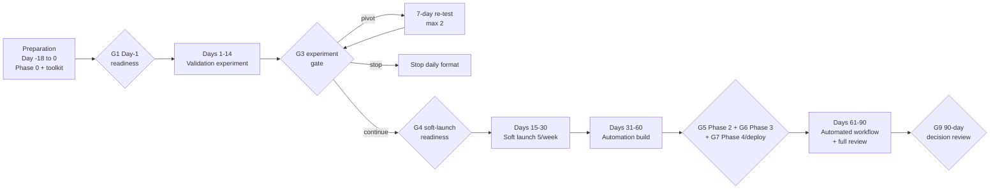
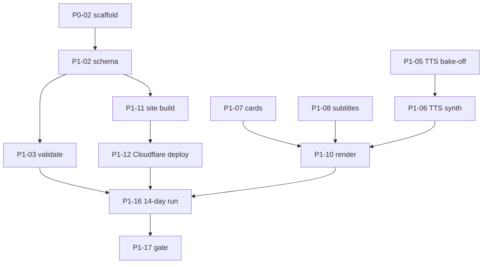

# Implementation Roadmap — AI Daily Brief

Status: **Planning baseline v1** (2026-11-07). The task-level detail is in [TASKS.md](../TASKS.md).
Related: [IMPLEMENTATION_STRATEGY](IMPLEMENTATION_STRATEGY.md) · [TECHNICAL_DECISIONS](TECHNICAL_DECISIONS.md)

## How gates work

- Each phase ends with a **gate review task** (P*n*-last). It records measured evidence in `docs/gates/phase-N.md` and a decision: **go**, **adjust** or **stop**.
- **Gates control what reaches production and what the business commits to.** Code for the next phase may be prototyped on a branch while a gate's measurement window is still running. It is not deployed to the daily pipeline, and nothing is promoted until the gate passes. Code having been written never counts as passing a gate.
- Effort is given in **engineering days**, meaning about 6 focused hours, for one founder-developer. Calendar time also includes the daily editorial work and the 10-day stability windows.

## Overview

```mermaid
flowchart LR
  P0[Phase 0<br/>Repo + discovery<br/>2-3 d] --> P1[Phase 1<br/>Manual prototype<br/>8-10 d build + 14 d run]
  P1 -->|gate| P2[Phase 2<br/>Ingestion<br/>8-10 d + 10 d window]
  P2 -->|gate| P3[Phase 3<br/>Editorial intelligence<br/>10-12 d + 10 d window]
  P3 -->|gate| P4[Phase 4<br/>Media automation<br/>3-4 d + 10 renders]
  P4 -->|gate| P5[Phase 5<br/>Website + archive<br/>5-6 d]
  P5 -->|gate| P6[Phase 6<br/>Instagram API<br/>5-7 d + Meta setup + 10 publishes]
  P6 -->|gate| P7[Phase 7<br/>Email + analytics<br/>5-6 d]
  P7 -->|gate| P8[Phase 8<br/>Commercial validation]
```

**Calendar.** The approved sequence is a **preparation window** (Phases 0–1 toolkit) followed by **90 days counted from experiment Day 1**. See the [approved 90-day plan](#approved-90-day-plan) below. Phases 5–8 complete after Day 90. **Dates are targets; gates decide.**

---

## Approved 90-day plan

*Approved sequence 2026-11-07.* Day numbers count from **experiment Day 1**. Every window starts only when its entry gate passes, and a slip moves everything after it.

| Window | Objective | Entry gate / dependencies | Work | Exit evidence |
|---|---|---|---|---|
| **Preparation (Day −18 to 0)** | Make the experiment possible | Approved decisions; user accounts created (TASKS §A) | P0-01–P0-03; P1-02–P1-12 toolkit; P1-05 and P1-09 bake-offs; P1-19 instruments; panel (P1-18, P1-21, P1-22) and auditor (P1-23) | **G1 readiness gate**: every mandatory item in the [Day-1 readiness checklist](gates/G1_DAY1_READINESS.md) |
| **Days 1–14: editorial validation** | Test accuracy, usefulness, distinctiveness and sustainability | G1 passed | ≥ 10 editions; 8–12 reader panel; independent auditor; production time, errors and improvements logged; **G2** Day 7 checkpoint | **G3** gate (P1-17): continue / pivot / stop under the pre-registered rules |
| **Days 15–30: public soft launch** | Start audience learning without automation risk | G3 = continue **and** G4 soft-launch readiness: brand and domain (P0-05), Instagram account (P1-15), policy pages (P1-20 / P1-20U), `noindex` removed | 5 editions a week, manual upload; public issue pages with source links; audience feedback and available metrics (Instagram Insights in-app, Cloudflare Web Analytics); full review of manual editions; **Phase 2 engineering starts** (staging) | ≈ 11 public editions; weekly review notes |
| **Days 31–60: automation development** | Automate ingestion, dedupe, evidence collection and editorial assistance | Phase 2 work started; VPS and Supabase accounts (user); P1-09 model decisions | Phase 2 (P2-01…P2-17), Phase 3 (P3-01…P3-15). Failure handling, budget ladder (LLM cap **$20** for this window, PD-02) and audit logging are tested. **Human approval stays mandatory** | **G5** Phase 2 gate (10 consecutive days of ingestion); **G6** Phase 3 gate (10 consecutive editions), targeted at about Day 60–65 |
| **Days 61–90: reliability and audience validation** | Run the automated workflow and evaluate it honestly | G6, then **G7**: Phase 4 gate (P4-06) + deploy jobs (P5-04) | Narration, render and deploy automation (Phase 4, P5-04); **automated workflow starts after G6 and G7** (target Day 65–75); full review of the first 30 automated editions; reliability, quality, audience and cost tracked | **G9** 90-day decision review ([TASKS §C](../TASKS.md#c-decision-gates-and-milestones)): continue / adjust / pause |

**Feasibility notes (documented at finalisation, not hidden):**
1. **The experiment can't start on project day 1**, because the toolkit takes about 12 engineering days. Hence the preparation window.
2. **The Days 31–60 scope is about 29 engineering days** (Phases 2, 3 and 4 plus the deploy jobs) plus stability windows. To keep the sequence realistic, Phase 2 engineering starts in Days 15–30, and narration, render and deploy automation is expected in Days 61–75. The approved order is kept; some calendar targets will likely move by up to 2 weeks, and the gate decides.
3. **The first 30 automated editions can't finish by Day 90.** At 5 a week, 30 editions take 6 weeks. If the automated workflow starts around Day 70, expect about 14 automated editions by Day 90 (about 11–18 depending on the gates). Full review continues past Day 90, and the G9 review evaluates partial automated-epoch evidence and says so.
4. **Instagram publishing stays manual through Day 90.** Phase 6 (API publishing) and Phase 7 (email) follow the 90-day review.
5. **Founder load peaks in Days 31–60** at about 32 h/week (STRATEGY §6.5). If weekly hours exceed the plan by more than 20% for 2 weeks, engineering scope moves later. Editorial quality and cadence are not cut first (R24).

## Phase 0 — Repository and technical discovery

| Item | Detail |
|---|---|
| Business objective | Settle name, handle and domain; decide the open questions needed to start |
| Engineering objective | A reproducible project skeleton and toolchain, plus a secrets policy |
| Dependencies | None. Discovery is complete (see [Strategy §2](IMPLEMENTATION_STRATEGY.md#2-technical-discovery-report)) |
| Components / files | `.gitignore`, `.env.example`, `pyproject.toml`, `brief/cli.py`, `brief doctor`, CI |
| Tasks | P0-01 … P0-05 |
| Acceptance | `uv run brief --help` works; gitleaks blocks a planted secret; `brief doctor` passes on the Mac |
| Testing | Smoke test; CI pipeline |
| Risks | Over-engineering the scaffold. Keep it minimal |
| Effort | 2–3 engineering days, plus founder decisions |
| **Exit gate** | P0-01 and P0-02 are done. The brand, handle and domain (P0-05) are needed only by soft-launch gate G4 (Day 15) |

## Phase 1 — Manual editorial prototype

| Item | Detail |
|---|---|
| Business objective | Prove that the editorial promise can be delivered at a sustainable time cost: useful, accurate and source-linked |
| Engineering objective | Tools that make a manual edition fast and safe: schema validation, link checks, TTS, cards, subtitles, render, static site, an LLM-assisted draft. No database, no n8n ([ADR-009](TECHNICAL_DECISIONS.md#adr-009)) |
| Dependencies | Phase 0 gate |
| Components | `brief/edition/` (schema, checks), `brief/net.py`, `brief/tts/`, `brief/media/` (cards, subtitles, render, probe), `brief/site/` (build, deploy), `brief/llm/` (minimal), `site_templates/`, `video_templates/`, `editions/` |
| Tasks | P1-01 … P1-17 |
| Acceptance (per tool) | See TASKS. In short: `brief validate` blocks bad editions; `brief render` produces a spec-valid MP4 deterministically; `brief site build` and `deploy` publish `/today` |
| Testing | Unit tests per check; golden PNGs and a golden ffprobe manifest; fixture editions; recorded HTTP cassettes for TTS and LLM |
| Risks | Tooling takes so long that the editorial test is delayed. **Mitigation:** the run can start with `validate` + `render` + `site build`; the LLM draft (P1-13) is optional. A second risk is that the TTS voice is poor on AI names; the P1-05 bake-off and lexicon address that |
| Effort | 8–10 engineering days to build, then the 14-day run at about 2.5 h/day editorial |
| Public exposure | During the experiment: private (reader panel, `noindex` site). If the gate says **continue**: a public **soft launch at 5 editions a week** with manual upload ([ADR-017](TECHNICAL_DECISIONS.md#adr-017), **approved**), after gate G4 (brand and domain, Instagram account, policy pages P1-20 / P1-20U) |

**Phase 1 exit gate (P1-17).** It is run as the pre-registered [14-day validation experiment](VALIDATION_EXPERIMENT.md). The thresholds are fixed before Day 1.
- **Must-pass:**
  - ≥ 10 complete editions;
  - H2 accuracy and provenance: 100% of material claims evidenced, and **0 unresolved** material errors. Corrected errors stay in the append-only error log; ≤ 1 in total, and ≥ 2 triggers stop rule 1;
  - H4 usefulness: panel mean ≥ 3.8/5 with ≥ 50% response rate. This is an **early qualitative signal, not product-market fit**;
  - H6 render and deploy stability.
- **Should-pass:**
  - H1 supply: ≥ 5 eligible stories on ≥ 10 of 14 days, and ≥ 3 every day;
  - H3 time: median ≤ 150 min and last-5 median ≤ 130;
  - H5 distinctiveness and coverage.
- **Decision:** **continue** (all must-pass met, at most one should-pass missed with a documented fix), **pivot** (a 7-day re-test with a named format change, at most 2), or **stop**. The full rules are in [VALIDATION_EXPERIMENT §8](VALIDATION_EXPERIMENT.md#8-decision-rules-at-day-14-p1-17). Don't automate a format that hasn't passed.

## Phase 2 — News ingestion automation

| Item | Detail |
|---|---|
| Business objective | Cut research time by putting the day's candidates in one place, deduplicated |
| Engineering objective | Postgres control plane, migrations, job queue, worker, ingest adapters, clustering, n8n scheduling and alerts, backups |
| Dependencies | Phase 1 gate; OD-05 (VPS); OD-08 (cash ceiling) |
| Components | `migrations/0001`, `0002`; `brief/db/`, `brief/jobs/`, `brief/ingest/`, `brief/intel/cluster.py`; `ops/launchd`, `ops/vps`, `ops/backup.sh`; n8n WF-01, WF-09, WF-10, WF-11 |
| Tasks | P2-01 … P2-16 |
| Acceptance | Each ingest re-run inserts 0 duplicates; queue concurrency test passes; clustering reaches ≥90% duplicate recall and ≤5% false merges on the labelled set; a restore test succeeds |
| Testing | A local Docker Postgres integration suite (migrations, triggers, queue); recorded feed fixtures; a labelled clustering evaluation set |
| Risks | Feed quirks (missing dates, HTML in titles). Over-clustering hides distinct news; mitigated by conservative thresholds and the editor seeing borderline pairs |
| Effort | 8–10 engineering days, plus a 10-day measurement window |
| **Exit gate (P2-16)** | **10 consecutive days** of scheduled ingestion: every fetch run ends in a recorded terminal state (no silent failures), alerts fire on the injected failures, dedupe metrics are recorded, and the backup and restore test passes. **The editor uses the candidate pool for that day's edition**, which is still assembled manually |

## Phase 3 — Editorial intelligence

| Item | Detail |
|---|---|
| Business objective | A ready-to-review draft edition in front of the editor shortly after the cutoff, with the rules applied and claims mapped to evidence |
| Engineering objective | Hard rules, scoring, the LLM client with budgets, claim extraction and verification, script and copy generation, the shortlist and selection forms, `prepare_issue` |
| Dependencies | Phase 2 gate; P1-09 model choice |
| Components | `brief/llm/`, `brief/intel/rules.py`, `score.py`, `injection.py`; `brief/claims/`; `brief/edition/assemble.py`; prompts `triage.v1`, `claims.v1`, `script.v1`; n8n WF-00, WF-02, WF-03, WF-04, WF-13 |
| Tasks | P3-01 … P3-13 |
| Acceptance | Fabricated URLs and excerpts are always dropped; the DB refuses unsupported "supported" claims; blocking checks gate `scripted`; budgets are enforced; the LLM regression set passes |
| Testing | A fake LLM provider for unit tests; the frozen 20-story regression set run on every prompt or model change; adversarial injection fixtures; end-to-end runs on replayed days from Phase 2 data |
| Risks | The LLM over-trusts vendor claims (handled by claim types, C07 and review). Costs creep up (hard caps, weekly report). Editor time doesn't fall (measure it; simplify the forms) |
| Effort | 10–12 engineering days, plus a 10-day window |
| **Exit gate (P3-13)** | Production epoch 2 starts here: the next 30 editions get full review ([EDITORIAL_PIPELINE §9](EDITORIAL_PIPELINE.md#9-human-review)). **10 consecutive editions** (publishing days) where a prepared issue reached `scripted` (or a documented quiet-day decision) by 18:00 IST; **0 unsupported material claims** reached the review stage; LLM cost stayed within cap; editor edit time per edition is recorded and below the Phase 1 average |

## Phase 4 — Media production automation

| Item | Detail |
|---|---|
| Business objective | Render without hands-on work, so the editor only watches and approves |
| Engineering objective | The heavy-queue render job, the R2-backed TTS cache, validation as code, template versioning, licence enforcement |
| Dependencies | Phase 3 gate (needs scripts in the DB) |
| Components | `brief/media/`, `brief/tts/cache.py`, `video_templates/VERSION` |
| Tasks | P4-01 … P4-06 |
| Acceptance | Identical inputs ⇒ no re-render; any spec violation blocks `rendered`; any unlicensed asset blocks the render |
| Testing | Golden manifest; spec rule tests; fallback-provider test |
| Risks | The Mac is asleep at render time (heartbeat alert, `caffeinate`); provider voice drift (pin the model and voice IDs) |
| Effort | 3–4 engineering days |
| **Exit gate (P4-06)** | **10 consecutive automated renders** with no manual fix; p95 render time recorded (target under 10 minutes including TTS) |

## Phase 5 — Website and archive (DB-backed site; the public soft launch started at G4)

| Item | Detail |
|---|---|
| Business objective | A public, trustworthy daily issue page and archive that viewers can use, and a "link in bio" that is worth clicking |
| Engineering objective | DB-backed site build, archive filters, SEO, corrections, preview → approval → go-live, enforcement of the first-30 review rule, policy pages, analytics |
| Dependencies | Phase 4 gate |
| Components | `brief/site/`, `site_templates/`, n8n WF-05, WF-12, SQL guards |
| Tasks | P5-01 … P5-09 |
| Acceptance | Go-live is impossible without approval; `/today` always points at the newest `site_live` issue; filters work; Lighthouse targets are met |
| Testing | Build snapshot tests; link and HTML validation; a state-guard test ("cannot go live unapproved"); a manual mobile check |
| Risks | Thin auto-generated pages (the ≥3-stories rule for topic pages); a correction workflow that is too slow (form-based, 4 h SLA for critical) |
| Effort | 5–6 engineering days, plus founder policy writing |
| **Exit gate (P5-09)** | Compliance checklist done ([RISKS_AND_OPERATIONS §11](RISKS_AND_OPERATIONS.md#11-compliance-checklist-before-phase-5-launch)); restore rehearsal done; Supabase Pro decision made. The DB-backed site, archive and approval flow replace the Phase 1 toolkit for the soft launch. Reels are still uploaded by hand; the **daily cadence starts at the Phase 6 gate** ([ADR-017](TECHNICAL_DECISIONS.md#adr-017)) |

## Phase 6 — Instagram automation

| Item | Detail |
|---|---|
| Business objective | Reliable scheduled publication at 20:00 IST with no duplicate posts and no unreviewed content |
| Engineering objective | Meta app and permissions, token lifecycle, `publish_reel` state machine, reconciliation, scheduling, dry run |
| Dependencies | Phase 5 gate; Meta account readiness (P6-02 can start in Phase 5, because app setup has its own lead time) |
| Components | `brief/publish/`, n8n WF-06, WF-07 |
| Tasks | P6-01 … P6-08 |
| Acceptance | Contract tests for all container states; a simulated ambiguous publish never creates a second post; tokens never appear in logs |
| Testing | Recorded API responses; ≥5 dry-run or test-account publishes; chaos test (kill the worker during `publishing` → reconcile) |
| Risks | Meta permission or review delays (start P6-01 and P6-02 early); API changes (pinned version, quarterly review); the presigned URL is rejected (fallback: public object after approval) |
| Effort | 5–7 engineering days, plus Meta setup lead time |
| **Exit gate (P6-08)** | **10 consecutive scheduled publishes** (at the approved cadence), each reconciled to a `media_id` or an explicit terminal state, **0 duplicate posts**, and every credential stored securely. Cross-posting may be *evaluated* only after this (P7-09) |

## Phase 7 — Analytics and audience ownership

| Item | Detail |
|---|---|
| Business objective | Turn social reach into an owned audience; measure what helps without compromising accuracy |
| Engineering objective | Email provider integration (double opt-in, per-issue campaign), Instagram insights, site metrics, a KPI report, feedback guardrails |
| Dependencies | Phase 6 gate (insights need reliable publishing); P7-01–P7-03 can start after the Phase 5 gate |
| Components | `brief/email/`, `brief/metrics/`, migrations for `reel_metrics`, `site_metrics`, `email_deliveries`; n8n WF-08, WF-13 v2 |
| Tasks | P7-01 … P7-09 |
| Acceptance | One email per issue across retries; KPIs use the documented denominators; metrics code cannot change verification thresholds (test) |
| Testing | Mocked provider tests; a double opt-in test on a real address; a metric-window scheduling test |
| Risks | Email deliverability (domain authentication); privacy obligations (OD-09); misreading small samples (treat targets as hypotheses until 30 editions) |
| Effort | 5–6 engineering days |
| **Exit gate (P7 gate)** | Signup live with double opt-in; KPIs tracked with the correct denominators. (The **90-day decision review is gate G9**, held at about Day 90 before Phase 7; it applies the business plan's diagnostic rules to the soft-launch evidence) |

## Phase 8 — Commercial validation

| Item | Detail |
|---|---|
| Business objective | Learn whether disclosed sponsorships, affiliates or premium analysis are viable, without compromising editorial independence |
| Engineering objective | Disclosure enforcement (C11), sponsored-segment template, affiliate link attributes. Nothing else is built until demand is evidenced |
| Dependencies | G9 90-day review says continue; at least 60 days of consistent publication (business plan commercial-readiness gate) |
| Tasks | P8-01 … P8-06 |
| Acceptance | An undisclosed sponsored issue cannot be approved; the media kit contains only measured numbers |
| Risks | Sponsor influence on selection (independence policy, register); disclosure non-compliance (verify current ASCI/CCPA guidance) |
| Effort | 2–3 engineering days, the rest is founder sales work |
| **Exit gate (P8-06)** | One disclosed pilot completed, or a documented repositioning decision |

---

## Critical path and parallelism

- **Founder tasks that run in parallel with engineering:** P0-05, P1-01, P1-15. Start Meta setup (P6-01, P6-02) during Phase 5, because it has external lead time.
- **Optional in Phase 1:** P1-09 and P1-13 (LLM assistance). The run can begin without them.
