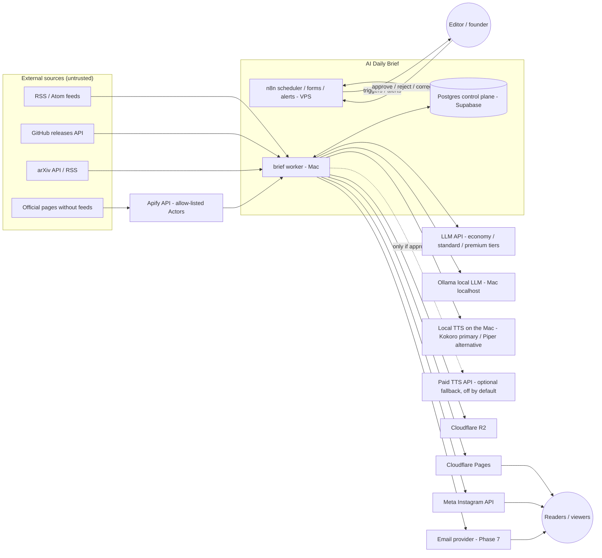
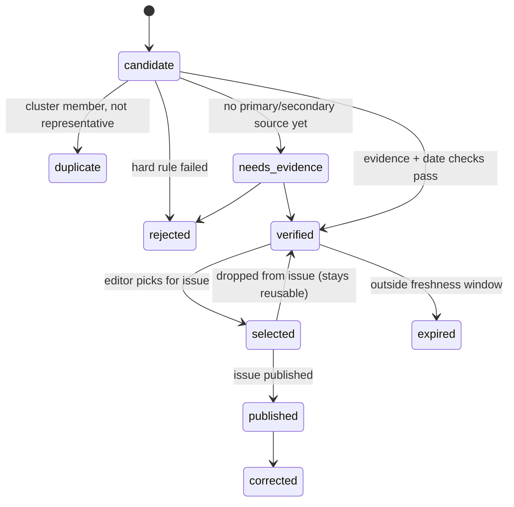
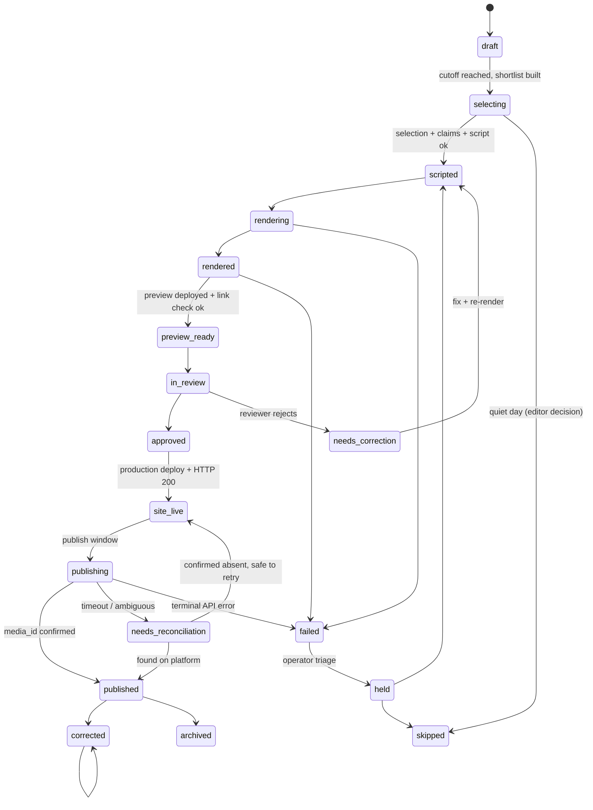
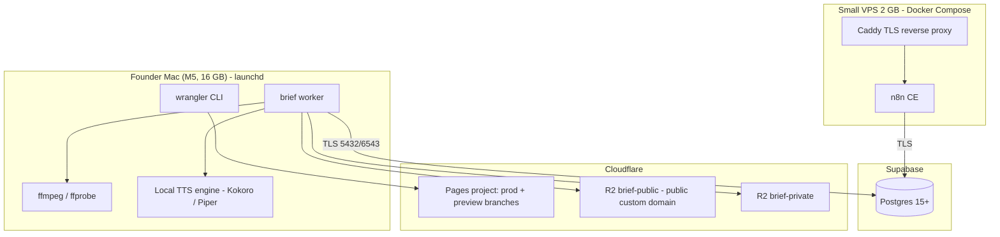

# System Architecture — AI Daily Brief

Status: **Planning baseline v1** (2026-11-07). Nothing here is implemented yet.
Related: [DATABASE_DESIGN](DATABASE_DESIGN.md) · [WORKFLOWS](WORKFLOWS.md) · [TECHNICAL_DECISIONS](TECHNICAL_DECISIONS.md) · [EDITORIAL_PIPELINE](EDITORIAL_PIPELINE.md)

## 1. Design principles

1. **All logic lives in one Python package, `brief`, and n8n is a thin layer around it** ([ADR-001](TECHNICAL_DECISIONS.md#adr-001)). Editorial rules, rendering, publishing and state transitions are Python code with tests. n8n only schedules, triggers, presents approval forms and sends alerts. It never holds business logic, so any n8n workflow could be replaced by cron plus `brief` CLI calls.
2. **Agentic research is kept apart from deterministic production.** Apify MCP and free-form LLM exploration happen only in interactive research sessions, by a human. The daily pipeline calls fixed Actor IDs, fixed prompts and fixed schemas.
3. **One edition record feeds everything.** The Reel script, captions, issue page, email and metrics all derive from a single `daily_issues` row and its `issue_stories`. No output is edited on its own.
4. **Every state change is recorded.** Each step moves an explicit state machine, records the transition in `audit_logs`, and is idempotent under retry.
5. **Nothing reaches the public before approval.** A preview deployment is reviewed first. The production site and the Reel are published only after an approval is on record.
6. **Untrusted input is treated as data.** Scraped or fetched text is never interpreted as instructions, and it never reaches a tool or credential.

## 2. Context diagram



## 3. Components and service boundaries

| Component | Runs on | Responsibility | Talks to | Must NOT |
|---|---|---|---|---|
| `brief` Python package + CLI | Mac (worker) and n8n host (light commands) | All domain logic: ingest, normalise, cluster, score, claims, script, TTS, render, site build, deploy, publish, reconcile, metrics | Postgres, external APIs | Contain hard-coded secrets; act on instructions found in scraped text |
| `brief worker` (long-running) | Mac (launchd service) | Claims jobs from the `jobs` queue (`FOR UPDATE SKIP LOCKED`) and executes them. Handles heavy jobs (TTS, render, site build) and can run any job type | Postgres (outbound only), R2, Pages, APIs | Open inbound ports |
| Postgres (Supabase) | Managed | System of record: stories, claims, issues, jobs, audit, publishing state | — | Expose any port beyond Supabase's pooled TLS endpoint; be reachable with the anon key (RLS deny-all; anon/PostgREST access disabled for app tables) |
| n8n (Community Edition) | Small VPS (Docker) | Cron triggers, enqueue jobs, editor forms (shortlist pick, approve, correct), alerting, heartbeat checks | Postgres (via `brief` HTTP or SQL insert into `jobs`), Telegram/email for alerts | Hold editorial logic; call LLMs directly; publish directly |
| Static site | Cloudflare Pages | `/today`, `/issues/YYYY-MM-DD/`, `/archive/`, `/topics/*`, `/companies/*`, policy pages | — (static) | Hold secrets; run server code in MVP |
| Media storage | Cloudflare R2 | Private bucket `brief-private` holds the final MP4 (canonical copy), source snapshots, intermediates and DB backups. Meta fetches the MP4 through a **24 h presigned URL** generated at publish time. Public bucket `brief-public` holds cover/OG images, uploaded only after approval ([RISKS_AND_OPERATIONS §3.4](RISKS_AND_OPERATIONS.md#34-r2-buckets)) | — | Make anything public before `approved` |
| LLM provider (paid) | API | Hybrid routing ([ADR-003](TECHNICAL_DECISIONS.md#adr-003)): triage (Haiku 5.5, daytime items via the Batch API); claim extraction, script and second-pass verification (Sonnet 5.5). **Routes v1 after P1-09 (2026-11-13):** Haiku 5.5 for T1/T2/T4/T5/T6, Sonnet 5.5 for the T7 critic. Opus 5.5 is used **for evaluation and testing only** and never in production routing. A fallback vendor is used for outages only | — | Choose tools or URLs; be called without a spend cap |
| Local LLM (Ollama) | Mac, localhost only | T1 scope, category and entity tagging; T2 same-event adjudication. Automatic Haiku fallback | `brief` worker only | Run during the render window; handle claims or script; listen on a non-loopback interface |
| TTS engine (local) | Mac, inside the worker process | Narration per segment through the provider-independent `TTSProvider` interface. Kokoro primary, Piper (`en_GB-cori-medium`) alternative, both provisional until the P1-05 benchmark ([ADR-004](TECHNICAL_DECISIONS.md#adr-004)); cached by hash | — (offline after model download) | Use a voice without a commercial-use licence record; re-synthesise identical text |
| Paid TTS API (optional) | API | Fallback only if no local engine passes, or by founder approval; off by default; capped per budget period | — | Run without `Budget.check`; become a mandatory dependency |
| Meta Instagram API | API | Reel container → status poll → publish | — | Be called by anything except `brief publish reel` / `reconcile` |

### Why the work is split this way
- **Heavy work runs on the Mac** (M5 / 16 GB) because FFmpeg rendering is CPU-heavy and the Mac already exists, so it costs ₹0. If the Mac is off at cutoff, n8n's heartbeat check alerts the editor and the issue goes to `held` ([RISKS_AND_OPERATIONS §6](RISKS_AND_OPERATIONS.md)). Moving render work to a cloud render API is [ADR-005](TECHNICAL_DECISIONS.md#adr-005).
- **The scheduler sits on a separate VPS** so it can still alert when the Mac is down. A scheduler running on the Mac could not report the Mac's own outage.
- **Postgres is managed** (Supabase), so the founder does not run database operations. Nightly `pg_dump` goes to private R2 because the free-tier backup guarantees are weak ([ADR-002](TECHNICAL_DECISIONS.md#adr-002)).

## 4. Repository layout (target)

```
/
├── CLAUDE.md, TASKS.md, README.md
├── pyproject.toml               # uv-managed, Python 3.12
├── brief/                       # the only application package
│   ├── cli.py                   # Typer entry point: `brief ...`
│   ├── config.py                # pydantic-settings; reads env only
│   ├── db/                      # psycopg 3 pool, query modules, state-machine guards
│   ├── jobs/                    # queue claim/complete/fail/dead-letter, worker loop
│   ├── ingest/                  # rss.py, github.py, arxiv.py, apify.py, normalise.py, canonical_url.py
│   ├── intel/                   # cluster.py, score.py, freshness.py, rules.py (hard rejections)
│   ├── claims/                  # extract.py, evidence.py, verify.py
│   ├── edition/                 # assemble.py, schema.py (pydantic), export.py, import_.py
│   ├── llm/                     # client.py (provider-agnostic interface), prompts/, budget.py
│   ├── tts/                     # base.py (TTSProvider), service.py, cache.py, providers/ (kokoro, piper, paid)
│   ├── media/                   # cards.py (Pillow), subtitles.py, render.py (FFmpeg), probe.py
│   ├── site/                    # build.py (Jinja → static), search_index.py, deploy.py (wrangler)
│   ├── publish/                 # instagram.py, reconcile.py, tokens.py
│   ├── metrics/                 # instagram_insights.py, site_analytics.py
│   └── audit.py
├── schemas/                     # JSON Schema (generated from pydantic, committed)
├── migrations/                  # 0001_init.sql, 0002_... (plain SQL, forward-only)
├── site_templates/              # Jinja templates + static CSS/JS (no framework)
├── video_templates/             # card layouts, fonts (licensed), brand palette, intro/outro
├── editions/                    # Phase 1: YYYY-MM-DD.json (source of truth before DB)
├── n8n/                         # exported workflow JSON (credentials stripped)
├── ops/                         # launchd plist, docker-compose for n8n, backup scripts
├── research/                    # Apify MCP / Actor evaluation notes (human-only)
├── docs/
└── tests/                       # unit, golden-file, contract tests
```

## 5. Daily data flow

```mermaid
sequenceDiagram
  autonumber
  participant N as n8n
  participant DB as Postgres
  participant W as brief worker (Mac)
  participant E as Editor
  participant L as LLM API
  participant T as Local TTS (Mac)
  participant P as CF Pages
  participant R as R2
  participant M as Meta API

  loop hourly 06:00-17:00 IST
    N->>DB: enqueue ingest jobs (one per due source)
    W->>DB: claim job, fetch, normalise, upsert candidates
  end
  N->>DB: 17:00 cutoff - enqueue final ingest + cluster + score
  W->>L: triage hints (structured JSON, budget-capped)
  W->>DB: shortlist (score + rule results)
  N->>E: shortlist form (select / reject / reorder)
  E->>N: selection
  N->>DB: record review, enqueue claims + script
  W->>L: claim extraction + script draft (schema-validated)
  W->>DB: claims, evidence, script; automated checks
  W->>T: narration per segment (cache by hash)
  W->>W: cards + subtitles + FFmpeg render + ffprobe validation
  W->>R: upload MP4 (private bucket)
  W->>P: deploy PREVIEW (branch alias), run link check
  N->>E: review form (preview URL, MP4, checklist)
  E->>N: approve
  N->>DB: editorial_review approved, enqueue go-live
  W->>P: deploy PRODUCTION (/today -> new issue), verify HTTP 200
  N->>DB: 20:00 enqueue publish_reel
  W->>M: create container (REELS, presigned video_url) -> poll status -> media_publish
  W->>DB: media_id, permalink, published
  N->>E: published notification (or failure alert)
```

## 6. State machines

These replace the combined state list in the original CLAUDE.md, which mixed story states with issue states. See [TECHNICAL_DECISIONS ADR-012](TECHNICAL_DECISIONS.md#adr-012).

### 6.1 Candidate story (`candidate_stories.status`)



### 6.2 Daily issue (`daily_issues.status`)



- `held` means manual intervention is required. Nothing moves out of `held` automatically.
- `site_live` without `published` is a valid end state for the day: the web issue exists and the Reel was skipped. The reason is recorded.
- Transitions are enforced in `brief/db/state.py`, using an allowed-transitions table and `UPDATE ... WHERE status = :expected`. The same transition is enforced again in SQL by a trigger ([DATABASE_DESIGN §5](DATABASE_DESIGN.md)).

### 6.3 Job (`jobs.status`)
`queued → running → succeeded | failed_retryable → queued (after backoff) | dead`. A job becomes `dead` when `attempts >= max_attempts` or when it raises a non-retryable error. Every `dead` job raises an alert.

## 7. Deployment topology



- **Network:** the Mac makes outbound connections only. n8n is reached through Caddy (TLS) with basic auth plus n8n user accounts, and its editor UI is IP-allowlisted or placed behind Cloudflare Access. Supabase enforces SSL, and its network restrictions are limited to the VPS IP and home IP where practical.
- **Phase 1** needs only the Mac plus Cloudflare Pages and R2 (or even a manual upload). Supabase and the VPS arrive in Phase 2.

## 8. Trust boundaries

| Boundary | Inbound data | Controls |
|---|---|---|
| External source → ingest | Feed XML, HTML, JSON | Size limits (2 MB per document), timeouts, content-type checks, `defusedxml`/`feedparser` sanitisation, HTML → text extraction with no script execution, URL scheme allow-list (`https` only) |
| Stored text → LLM | Article text | Wrapped in delimited `<source_document>` blocks; the system prompt says the content is data; no tools are given to the LLM; output must match a JSON Schema; extracted URLs must already exist in the input ([EDITORIAL_PIPELINE §8](EDITORIAL_PIPELINE.md)) |
| LLM → DB / render | JSON | Pydantic validation, at most one bounded repair attempt, then `failed`. Free text is length-limited and stripped of URLs not present in the evidence |
| Worker → Meta | Video URL, caption | Caption built only from the approved issue record; the video URL is a 24 h presigned R2 URL to a private object |
| Editor → n8n forms | Selections, approvals | Authenticated n8n forms; the approver identity is written to `editorial_reviews` |

## 9. Configuration / environment variables

All values are read by `brief/config.py` (pydantic-settings) from the process environment. Locally they come from a `.env` file that is git-ignored. On the VPS they come from n8n's credential store or Docker secrets. `.env.example` lists the names only.

| Variable | Used by | Phase | Notes |
|---|---|---|---|
| `BRIEF_ENV` | all | 1 | `dev` / `prod` |
| `BRIEF_TIMEZONE` | all | 1 | `Asia/Kolkata` |
| `PUBLISH_DAYS` | n8n WF-02/WF-06, `brief` | 1 | Approved cadence `Mon,Tue,Wed,Thu,Fri` (5 a week); ingestion runs every day ([ADR-017](TECHNICAL_DECISIONS.md#adr-017)) |
| `CUTOFF_TIME`, `PUBLISH_TIME` | n8n, `brief` | 1 | Approved `17:00` and `20:00` IST |
| `BRIEF_SITE_BASE_URL` | site, captions | 1 | e.g. `https://<domain>` |
| `DATABASE_URL` | worker, n8n | 2 | Supabase pooled connection string, `sslmode=require` |
| `ANTHROPIC_API_KEY` | llm | 1 (P1-09, P1-13; optional in Phase 1) | Primary LLM |
| `LLM_FALLBACK_PROVIDER`, `LLM_FALLBACK_API_KEY` | llm | 3 | Optional fallback |
| `LLM_MONTHLY_BUDGET_USD`, `LLM_DAILY_BUDGET_USD` | llm/budget | 1 | Hard caps enforced in code before each call, **per plan window** from `BUDGET_PERIODS_FILE`: $10 (Days 1–30), $20 (Days 31–60, PD-02), $35 (Days 61–90 and after); $1.50/day |
| `BUDGET_PERIODS_FILE` | llm, tts, cost report | 1 | `config/budget_periods.yaml`: LLM and voice caps per plan window, plus the ₹15,000 ceiling and the ₹10,000 freeze threshold (P1-36) |
| `LLM_ROUTES_FILE` | llm | 1 | Path to `config/llm_routes.yaml`: task → tier → model ID ([ADR-003](TECHNICAL_DECISIONS.md#adr-003)). Model IDs are config, not code |
| `OLLAMA_BASE_URL` | llm (local tier) | 2 | `http://127.0.0.1:11434` (localhost only) |
| `HEALTHCHECKS_PING_URLS` | worker, n8n host, backup | 2 | External dead-man's switch ping URLs (healthchecks.io); treated as secrets |
| `TTS_CONFIG_FILE` | tts | 1 | `config/tts.yaml`: provider chain (default `kokoro`, `piper`), voice, pinned model versions and hashes, lexicon version, `paid_fallback.enabled: false` |
| `TTS_PAID_API_KEY` | tts (paid fallback) | — | Only if the founder approves the paid fallback; otherwise unset |
| `R2_ACCOUNT_ID`, `R2_ACCESS_KEY_ID`, `R2_SECRET_ACCESS_KEY` | media, backups | 1 | Scoped API token: object read/write on the two buckets only |
| `R2_PUBLIC_BUCKET`, `R2_PRIVATE_BUCKET`, `R2_PUBLIC_BASE_URL` | media | 1 | |
| `CLOUDFLARE_API_TOKEN`, `CLOUDFLARE_ACCOUNT_ID`, `CF_PAGES_PROJECT` | site deploy | 1 | Token: Account · Cloudflare Pages · Edit, own account only (Pages tokens can't be limited to one project). The `*.pages.dev` address is read from the API (`ai-daily-brief-7vb.pages.dev`) |
| `APIFY_TOKEN`, `APIFY_ALLOWED_ACTORS`, `APIFY_MAX_RUN_USD` | ingest | 2 | Allow-list enforced in code |
| `GITHUB_TOKEN` | ingest (releases) | 2 | Fine-grained, public-repo read only (raises rate limits) |
| `IG_USER_ID`, `META_APP_ID`, `META_APP_SECRET` | publish | 6 | App secret only on the host that refreshes tokens |
| `IG_ACCESS_TOKEN` | publish | 6 | **Stored in DB `platform_tokens`, encrypted** (`pgcrypto` with `BRIEF_TOKEN_KEY`) so that refreshes persist; never placed in logs |
| `BRIEF_TOKEN_KEY` | publish | 6 | Symmetric key for token encryption; kept out of the DB |
| `ALERT_TELEGRAM_BOT_TOKEN`, `ALERT_TELEGRAM_CHAT_ID` | n8n alerts | 2 | Or an email alert channel |
| `EMAIL_PROVIDER_API_KEY`, `EMAIL_LIST_ID` | email | 7 | |
| `BRIEF_WORKER_ID` | worker | 2 | Hostname-based, used for job leases and heartbeat |

## 10. Technology inventory (target)

| Concern | Choice | Phase | Why it is needed |
|---|---|---|---|
| Runtime | Python 3.12 via `uv` | 0 | System Python 3.9 is too old; uv gives reproducible locks |
| CLI | Typer | 0 | Small, typed CLI |
| Models / validation | pydantic v2 + `jsonschema` | 1 | One schema definition; JSON Schema exported for docs and tests |
| Templates | Jinja2 | 1 | Site and card HTML |
| Images | Pillow | 1 | Card rendering without a browser dependency |
| Video | FFmpeg 9.0.x (Homebrew; installed 9.0.2) | 1 | Assembly, encoding, loudness (`loudnorm`/`ebur128`); `ffprobe` validation. The standard build has no `ass`/`subtitles` filter, so the subtitle method is decided in P1-08 |
| HTTP | httpx | 1 | Timeouts, HTTP/2, retries via tenacity |
| Retries | tenacity | 1 | Bounded, jittered retries |
| Feeds | feedparser | 2 | RSS/Atom parsing |
| HTML → text | trafilatura | 2 | Main-content extraction without JS |
| DB driver | psycopg 3 (+ pool) | 2 | Plain SQL, no ORM, so the schema stays explicit |
| Fuzzy matching | rapidfuzz + Postgres `pg_trgm` | 2 | Title clustering; pgvector deferred ([ADR-008](TECHNICAL_DECISIONS.md#adr-008)) |
| Local TTS | `kokoro` (Apache-2.0, plus espeak-ng) primary; `piper-tts` (GPL-3.0, internal use only) alternative; installed for the P1-05 benchmark | 1 | ₹0 voice generation on the existing Mac ([ADR-004](TECHNICAL_DECISIONS.md#adr-004)) |
| LLM SDK | `anthropic` (official) | 1 | Structured outputs via JSON Schema; Message Batches for non-urgent work |
| Local LLM runtime | Ollama (Homebrew) + one ~8B-class model chosen in P1-09 | 2 | Local tier for T1/T2 ([ADR-003](TECHNICAL_DECISIONS.md#adr-003)); called over localhost HTTP with httpx, so no extra SDK |
| External heartbeat | healthchecks.io (free plan, *verify*) | 2 | Detects a dead Mac, VPS or backup job from outside our infrastructure |
| Deploy | `wrangler` (npm, Node 24 present) | 1 | Pages direct-upload deploys, previews by branch |
| Tests | pytest, pytest-recording (VCR) for HTTP, golden files | 0 | Deterministic tests without hitting live APIs |
| Lint / format / types | ruff, mypy (strict on `brief/`) | 0 | |
| Orchestration | n8n CE (Docker) | 2 | Schedules, forms, alerts only |
| Reverse proxy | Caddy | 2 | Automatic TLS for n8n |

Each dependency gets a one-line justification in its PR. No dependency is added "just in case".
