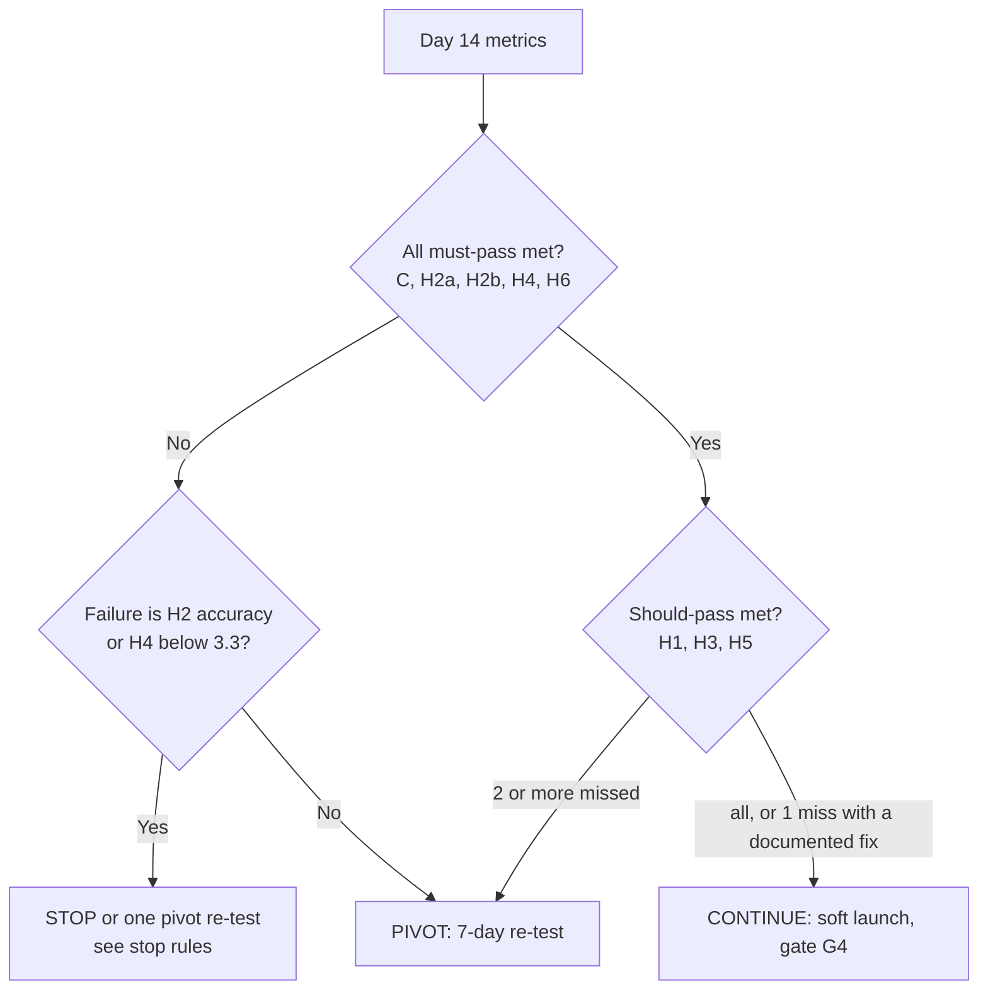

# 14-Day Editorial Validation Experiment

Status: **Approved design, finalised 2026-11-07.** Thresholds are fixed before Day 1. Implements P1-16 (run) and P1-17 (gate); recruitment and audit set-up in P1-18, P1-21–P1-24.
Related: [IMPLEMENTATION_ROADMAP §90-day plan](IMPLEMENTATION_ROADMAP.md#approved-90-day-plan) · [EDITORIAL_PIPELINE §9–§10, §14](EDITORIAL_PIPELINE.md) · [WORKFLOWS §7](WORKFLOWS.md#7-phase-1-manual-runbook-no-n8n-no-database) · [DECISION_REVIEW](DECISION_REVIEW.md)

> **Pre-registration rule:** the hypotheses, metrics and thresholds in §3 are fixed before Day 1 and are copied unchanged into `docs/gates/phase-1.md` (P1-25). The Day 7 checkpoint may change the *format*. It may never change the *thresholds*. No threshold may be loosened to make the experiment pass.

## 1. Purpose

Before spending on automation, find out whether one founder can produce a daily-style AI brief that is **accurate, useful, distinct and sustainable**. The experiment provides the evidence for the Phase 1 gate decision: **continue** (soft launch), **pivot** (re-test) or **stop**.

**What the experiment cannot prove.** A panel of 8–12 people is an **early qualitative signal**. It is not evidence of product-market fit, audience demand or monetisation. Those are tested by the soft launch and the 90-day review.

## 2. Timing and preconditions

**Day 1 is not the first day of the project.** The experiment needs the Phase 0–1 toolkit, which is about 12 engineering days. It is therefore preceded by a **preparation window** of about 2.5 weeks, called Day −18 to Day 0 ([ROADMAP](IMPLEMENTATION_ROADMAP.md#approved-90-day-plan)). The 90-day plan counts from experiment Day 1.

**Readiness gate G1 (Day 0).** Day 1 starts only when every **mandatory** item in the [G1 Day-1 readiness checklist](gates/G1_DAY1_READINESS.md) passes (M1–M18). That covers the source list, reference roundups, panel, form, auditor and practice audit, the rubric, the evidence records, templates, script and caption, render, links, the issue page, the error log, the tracking sheet, time blocks, signed thresholds and the budget tracker. There is no partial start. LLM-assisted drafting (P1-13) is an optional improvement; if it is used, it must be used on all days or none.

## 3. Hypotheses, metrics and thresholds (pre-registered)

| # | Hypothesis | Metric (source) | Threshold | Class |
|---|---|---|---|---|
| C | **Completion** | Complete editions: validated, rendered, page deployed, reviewed | ≥ 10 of 14 days | **Must-pass** |
| H2 | **Accuracy and provenance** | (a) % of material claims with supporting evidence records; (b) **unresolved** material or critical errors at Day 14; (c) total material or critical errors, **corrected or not**, from the append-only [error log](#9-data-captured) | (a) 100%; (b) **0**; (c) ≤ 1. Two or more triggers stop rule 1 even if all were corrected | **Must-pass** (a, b); (c) feeds the stop rule |
| H4 | **Usefulness** (early qualitative signal) | Daily item D1 "Today's brief was useful to me" (1–5); response rate | Mean of all D1 responses **≥ 3.8**, with panel response rate ≥ 50% of panel-days (otherwise the measure is **invalid**, not passed) | **Must-pass** |
| H6 | **Production stability** | Renders needing no manual FFmpeg or template fix; deploy success | ≥ 13/14 renders (≥ 90%); the last 5 renders pass validation first time; 100% of deploys succeed | **Must-pass** |
| H1 | **Supply** | Eligible stories per day: rules pass, score ≥ 55, evidence present | ≥ 5 eligible on ≥ 10 of 14 days, **and** ≥ 3 on every day | Should-pass |
| H3 | **Time** | Edition minutes (`production_log`; audit and panel overhead excluded) | Median ≤ 150 over all editions **and** median of the final 5 editions ≤ 130 | Should-pass |
| H5 | **Distinctiveness and coverage** | (a) W1 "meaningfully different from the AI-news sources I already use" on Days 7 and 14; (b) major-story misses vs the two reference roundups (discovery-only) | (a) ≥ 50% of respondents rate ≥ 4; (b) ≤ 2 misses of stories that met our rules | Should-pass |

**Diagnostics** (reported, not pass/fail): D2 clarity and pacing, D3 trust, D4 story selection, D5 "learned something new" (the v1 threshold of "≥ 60% say yes" is now measured as **≥ 60% of responses rating ≥ 4**), W2 likelihood of watching regularly, W3 likelihood of visiting the website. The derived post-automation time projection uses [EDITORIAL_PIPELINE §13](EDITORIAL_PIPELINE.md#13-human-involvement-model).

**Clarifications recorded at finalisation** (none of them loosens a threshold):
1. "Zero unresolved material errors" is the must-pass test. A corrected error **stays in the error log and still counts** toward H2(c) and stop rule 1. It is never erased or treated as if it didn't happen.
2. H3 "at most 130 minutes over the final five days" is the **median of the final five editions ≤ 130 minutes** (PD-05, **approved** 2026-11-07).
3. Questionnaire items moved from Yes/No to the 1–5 scale. The mappings are: "learned something new ≥ 60% Yes" becomes "≥ 60% rate D5 ≥ 4", and "would follow ≥ 50% / < 30%" becomes "W2 ≥ 4 for ≥ 50% / < 30%".
4. Rubric v1.1 (PD-06) is used. With a daily cadence its scores are identical to v1.0, so H1 is unaffected; the eligibility threshold of 55 is fixed for the experiment.

## 4. Daily workflow (IST, time-boxed)

The workflow is unchanged from the approved design. Time boxes are targets, and overruns are logged, never hidden.

| Time | Box | Step | Actions | Output / logged field |
|---|---|---|---|---|
| 16:10–17:00 | 50 min | **Research** | Scan allow-listed sources since the last cutoff. Log **every** candidate considered (title, URL, publisher, source type, published and event dates, collection time) and mark rejections with a rule code (R01–R12) | `experiment.candidates[]`, `production_log.minutes_research` |
| 17:00 | — | **Cutoff** | Nothing after 17:00 enters today's edition | `cutoff_at` |
| 17:00–17:30 | 30 min | **Score, select, verify** | Score with the rubric; select 3–7; record claims and evidence (tier, excerpt); run `brief validate` | `stories[].score`, `selected_reason`, `claims[]`, `minutes_verify` |
| 17:30–17:50 | 20 min | **Script** | Draft (by hand or with `brief script draft`); edit; `brief validate` | `script`, `caption`, `minutes_script` |
| 17:50–18:05 | 15 min | **Render** | `brief render`; **watch the whole MP4** | `media`, `minutes_render` |
| 18:05–18:15 | 10 min | **Site** | `brief site build` → `deploy --preview` → `brief linkcheck`. Send the preview link to the auditor **if they are available today** (§6.3) | `deployment.preview_url`, `minutes_site` |
| 18:15–18:30 | 15 min | **Review** | Fill the six-item checklist; go / no-go | `review`, `minutes_review` |
| 18:30–18:40 | 10 min | **Distribute** | Production deploy (`noindex`); send the private links (page + MP4) to the panel. **No public posting during the experiment** | `deployment`, `minutes_publish` |
| Next day 09:00 | 15 min | **Audit intake + panel check** | Read the auditor's findings (or self-audit if no auditor that day, §6); log errors; check panel response counts; write 3 lines in `daily-notes.md` | `experiment/audit-log.csv`, `error-log.csv`; overhead **not** counted in H3 |

The edition target is **≤ 150 minutes** a day, plus about 15 minutes of experiment overhead.

## 5. Reader panel: recruitment kit

All participation is **unpaid** (approved). Incentives need explicit founder approval. **The founder sends every message personally; nothing is sent on the founder's behalf.**

### 5.1 Who we want (8–12 people)
| Dimension | Target mix |
|---|---|
| Segment | ≥ 4 developers or AI builders · ≥ 3 students or technology professionals · ≥ 2 founders, PMs or operators |
| AI-news habit | ≥ 3 who follow AI news daily · ≥ 3 who follow it weekly or less |
| Short-video habit | All watch Reels or Shorts at least weekly; at least a few do so daily |
| Geography | Mostly India is fine; aim for ≥ 2 outside India (the editorial audience is global English-speaking) |
| Perspective | A spread of career stages; avoid an all-one-gender panel; at most half close friends or family; **no** co-founders or collaborators on this project |

### 5.2 Screening (ask before confirming)
1. How often do you read or watch AI news? (Daily / Weekly / Rarely)
2. Where do you get AI news today? (Free text. It feeds the H5 comparison.)
3. How often do you watch Instagram Reels or YouTube Shorts? (Daily / Weekly / Rarely)
4. Can you spend about 3 minutes on at least 10 of the 14 evenings from [start date]? (Yes / No)

Accept anyone who answers "Yes" to Q4 and fits the mix. Decline politely once the mix is filled. Recruit **14–15 to end with 8–12 active panelists**, because some will drop out.

### 5.3 Invitation message (WhatsApp, LinkedIn DM or personal message; edit freely)

> Hi [Name]! I'm testing a new idea: a short daily video (~60–90 seconds) on the most important AI developments, with a web page linking every story to its original source.
>
> Would you be one of 8–12 early reviewers for 2 weeks starting [date]? Each evening you'd get a private link, watch the video, and answer a 1-minute form (about 3 minutes total). Skipping a few days is fine.
>
> It's unpaid. Your answers are recorded under a code, not your name, and you can stop at any time. Honest criticism is the most useful thing you can give me.
>
> Interested? I'll send 4 quick screening questions. Thank you!

**Follow-up for confirmed panelists:** start date; the arrival time of the link (about 18:45 IST); the form link; a note that links are private and shouldn't be shared; and how to leave.

### 5.4 Questionnaire, with one consistent scale

**Scale for every rated item:** 1 = Strongly disagree · 2 = Disagree · 3 = Neutral · 4 = Agree · 5 = Strongly agree.

**Daily form (about 60–90 s):** panel code, date, "Watched the full video?" (Y/N)
| ID | Statement | Covers |
|---|---|---|
| D1 | Today's brief was useful to me. | Usefulness (H4) |
| D2 | The video was clear and well paced. | Clarity and pacing |
| D3 | I trust the information in today's brief. | Trustworthiness |
| D4 | Today's stories were the right ones to cover. | Story selection |
| D5 | I learned something I didn't already know. | Novelty (diagnostic) |
| D6 | *(optional text)* Anything wrong, confusing, missing or too long? | Error and quality signal |

**Day 7 and Day 14 add:**
| ID | Statement | Covers |
|---|---|---|
| W1 | This is meaningfully different from the AI-news sources I already use. | Originality (H5a) |
| W2 | If this were public, I would watch it regularly. | Likelihood of regular watching |
| W3 | I would visit the website to read the full stories and original sources. | Likelihood of visiting the site |
| W4 | *(text)* What would make this a must-watch for you? | Improvement ideas |

### 5.5 Response collection
- **One online form** (for example a free Google Form) with a panel-code dropdown and a date field. The founder creates it (P1-21). Responses go to a spreadsheet, which the founder exports to `experiment/panel-responses.csv` on Days 7 and 14 (codes only, no names).
- Send links **individually or by broadcast list, not in a group chat**, so panelists don't influence each other. Send at most **one reminder a day** (about 21:30).
- Keep the code-to-name mapping **outside the repo** (founder's private note).

### 5.6 Summarising feedback without overstating it
- Report **n, response rate and the full score distribution** (count of each 1–5 score), not just means. Also report the **median of per-panelist averages** and the **share of panelists whose average is ≥ 3.5**, so one or two enthusiasts can't carry the mean.
- Run **no significance tests** and make **no population claims** at n ≈ 10. Compare Days 1–7 with Days 8–14 as a direction only.
- Quote free text verbatim (anonymised) and group it into themes. Treat a repeated complaint as more informative than a high average.
- State the limitations in the gate document: a small, non-random, friendly sample; a novelty effect; no behavioural data (no real views or saves). **3.8/5 is an early qualitative signal, not product-market fit.**

## 6. Independent accuracy auditor

The founder has confirmed an independent volunteer (P1-23). The auditor **does not write or edit the scripts**, which keeps checking separate from production. The auditor is **not assumed to be available every day**.

### 6.1 Responsibilities
1. Independently open the **original sources** for the selected stories, not just our summaries.
2. Check that each **material claim** is supported by the cited evidence.
3. Identify **misleading framing, missing context, incorrect attribution** (especially vendor claims stated as fact), wrong dates or time words, and wrong numbers.
4. Record each discrepancy **with evidence** (URL + short excerpt) in the audit record.
5. **Escalate material or critical issues before publication where possible** (§6.3), otherwise immediately after.

### 6.2 Coverage
- **Next-morning audit:** 2 randomly sampled stories per edition (seeded from the edition date), about 15–20 min. **Target: ≥ 10 of 14 editions audited by the independent auditor.** On days the auditor is unavailable, the founder self-audits the next morning, marked `auditor_type = self`. Self-audits are reported separately as weaker evidence.
- **Pre-publication spot check (optional, when available):** the auditor gets the preview link at about 18:15 and checks the lead story. During the experiment, panel distribution goes ahead at 18:40, but any material issue raised before then **holds** the edition. During the soft launch, the 20:00 publish target leaves a window from 18:45 to 19:45.
- Audit coverage (number of editions and stories audited, by auditor type) is reported in the gate document.

### 6.3 Escalation
| Finding | When found | Action |
|---|---|---|
| Material or critical, **before publication** | Spot check | The auditor messages the founder at once. The edition is **held** until the claim is fixed, attributed or removed. Logged in the error log as `caught_pre_publication` (it still counts toward H2(c)) |
| Material or critical, **after publication** | Next-morning audit | The founder applies the [corrections process](EDITORIAL_PIPELINE.md#10-corrections) (critical within 4 h, material within 24 h). It is logged in the error log, and the **next 10 editions return to full review** |
| Minor | Any | Logged; fixed in the next build; batched in the daily notes |
| Disagreement between auditor and founder | Any | Both positions are recorded. The stricter reading applies until the evidence settles it |

### 6.4 Audit record (`experiment/audit-log.csv`, one row per checked claim)
`date, issue_key, story_rank, audit_type (pre_publication | next_morning), auditor_type (independent | self), claim_text, source_url_checked, finding (supported | unsupported | misleading_framing | missing_context | wrong_attribution | date_error | number_error | other), severity (none | minor | material | critical), evidence_url, evidence_excerpt, escalated_at, resolution, correction_ref, notes`

Every confirmed error is also appended to `experiment/error-log.csv`, which is **append-only**: corrections add `resolved_at` and `correction_ref` rows. Nothing is deleted.

## 7. Day 7 checkpoint (60 minutes)

1. Compute every metric for Days 1–7, including the Day 7 panel items.
2. **Allowed adjustments:** story count (3–7), time boxes, script length (60–90 s), card template, adding or removing up to 3 sources, step order.
3. **Not allowed:** changing thresholds, verification rules or rubric weights.
4. **Early pivot test:** if the H3 median exceeds 200 minutes, or H1 fails on more than 4 of 7 days, the founder may switch to the matching pivot format (§8) for Days 8–14. The gate then treats Days 8–14 as a 7-day re-test with the same thresholds, scaled (≥ 5 complete editions instead of ≥ 10). This counts as one of the two allowed pivots.

## 8. Decision rules at Day 14 (P1-17)

These rules are retained exactly as approved.

### Continue
All must-pass criteria are met, H2(c) ≤ 1, and at most one should-pass criterion is missed **with a documented adjustment**. The next step is the soft-launch readiness gate G4 ([ROADMAP](IMPLEMENTATION_ROADMAP.md#approved-90-day-plan)).

### Pivot (a 7-day re-test with a **named format change**; at most 2 pivots in total)
| Failing signal | Pivot to test |
|---|---|
| H1 supply | 3–5-story format; or 5 editions a week plus a weekend recap |
| H3 time | Fewer stories (3–5) with a simpler card style; bring forward automation of the slowest step |
| H4 usefulness 3.3–3.8 | Reposition: developer-focused "what shipped and how to use it" **or** a plain-language explainer. Test one, with a different hook |
| H5 not distinct | Niche down (open source and developer tools, or India's AI policy and ecosystem); or 3 stories with deeper "why it matters" |
| Completion < 10 for capacity reasons | Fewer stories per edition, then re-check H3 |

Each pivot delays the soft launch and every later milestone by at least 7 days.

### Stop (write down why)
1. **H2 fails structurally:** H2(c) ≥ 2, meaning two or more material or critical errors even if all were corrected, or any unresolved one at Day 14 that cannot be fixed with a format reduction.
2. **H4 mean is below 3.3 after one pivot**, and fewer than 30% of respondents rate W2 ≥ 4.
3. **Unsustainable even with automation:** the projected post-automation founder time is above 60 min per edition **and** the founder judges the fully loaded cost ([STRATEGY §6.5](IMPLEMENTATION_STRATEGY.md#65-founder-time-not-cash)) unacceptable.

"Stop" means stop the daily-style video format, not necessarily the idea.

## 9. Data captured

Everything lives in git, with no secrets and no personal data.

| File | Contents |
|---|---|
| `editions/YYYY-MM-DD.json` | The full edition with its audit trail ([EDITORIAL_PIPELINE §14](EDITORIAL_PIPELINE.md#14-mandatory-editorial-audit-trail)): `production_log`, and an `experiment` block (`candidates[]` with rule codes, `eligible_count`, `quiet_day`) |
| `experiment/panel-responses.csv` | `date, panel_code, watched_full, D1…D6, W1…W4` |
| `experiment/audit-log.csv` | §6.4 |
| `experiment/error-log.csv` | Append-only: `logged_at, issue_key, story_rank, source (auditor / self / panel / founder), severity, description, evidence_url, caught_pre_publication, resolved_at, correction_ref` |
| `experiment/coverage-misses.csv` | `date, reference_roundup, missed_story_url, met_our_rules (Y/N), reason` |
| `experiment/daily-notes.md` | Three lines a day |
| `docs/gates/phase-1.md` | Pre-registered thresholds (copied before Day 1), results, decision |

## 10. Experiment budget

| Item | Cash | Founder time |
|---|---|---|
| TTS for 14 editions | About ₹50–100 (cap $10/month) | — |
| LLM drafting (optional) | About ₹100 (Phase 1 cap $10/month) | — |
| Panel and auditor | **₹0** (unpaid, approved) | Recruitment and briefing about 4 h (preparation window) |
| Edition production | — | 14 × ≤ 150 min ≈ 35 h |
| Audit intake, panel checks, notes | — | 14 × 15 min ≈ 3.5 h |
| Day 7 checkpoint + gate analysis | — | About 7 h |
