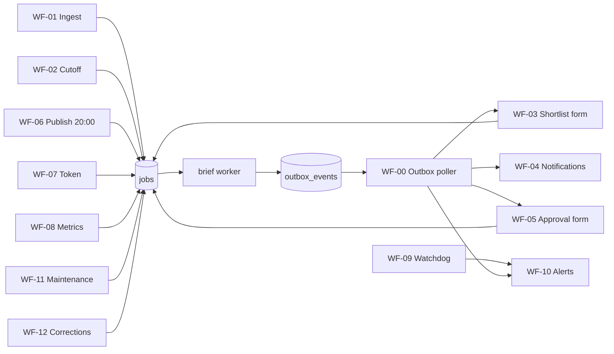

# Workflows — AI Daily Brief

Status: **Planning baseline v1** (2026-11-07).
Related: [SYSTEM_ARCHITECTURE](SYSTEM_ARCHITECTURE.md) · [DATABASE_DESIGN](DATABASE_DESIGN.md) · [EDITORIAL_PIPELINE](EDITORIAL_PIPELINE.md) · [RISKS_AND_OPERATIONS](RISKS_AND_OPERATIONS.md)

## 1. Division of labour

Following [ADR-001](TECHNICAL_DECISIONS.md#adr-001), work is split between three parts:

- **n8n** decides *when*: cron triggers, editor forms, notifications and alert routing.
- **Postgres** holds *what needs doing*: the `jobs` queue, plus the `outbox_events` table that carries events back to n8n.
- **The `brief` worker** decides *how*: it runs every job, and every chained step inside a job, in Python.

n8n talks to the database through a few **SQL functions** and **read-only views**, using a least-privilege role `brief_n8n`. That role can `EXECUTE` the `brief_*` functions and `SELECT` the `v_*` views. It cannot write to tables directly.

| SQL interface | Purpose |
|---|---|
| `brief_enqueue(job_type, queue, payload, idempotency_key, run_after, priority, max_attempts)` | Idempotent insert into `jobs` (`ON CONFLICT DO NOTHING`); returns the job id |
| `brief_ensure_issue(issue_date)` | Creates the `daily_issues` row in `draft` if it doesn't exist |
| `brief_record_review(issue_id, story_id, review_type, decision, reviewer, checklist, notes)` | Appends to `editorial_reviews`, then enqueues the next job when the decision allows it |
| `brief_record_selection(issue_id, reviewer, story_ids_in_rank_order, notes)` | Writes the shortlist selection (`issue_stories` ranks + review) and enqueues `prepare_issue` |
| `brief_record_correction(…)` | Appends to `corrections` and enqueues `rebuild_site` |
| `brief_ack_event(event_id)` | Marks an outbox event as delivered |
| `v_sources_due`, `v_shortlist`, `v_issue_review`, `v_outbox_pending`, `v_watchdog`, `v_weekly_report` | Read models for n8n |

**Events reach n8n through a transactional outbox, polled by n8n.** The worker writes `outbox_events` rows in the same transaction as each state change. n8n polls `v_outbox_pending` every minute, routes each event, and acknowledges it. As a result the Mac never calls n8n, no webhook secrets are needed, and no event is lost if n8n is down: it catches up when it comes back. These two tables are added to the MVP schema in [DATABASE_DESIGN §4.19](DATABASE_DESIGN.md#419-outbox_events-and-worker_heartbeats).

## 2. Job types

| job_type | queue | CLI equivalent | Idempotency key | max_attempts | Timeout | Notes |
|---|---|---|---|---:|---|---|
| `ingest_source` | light | `brief ingest run --source <key>` | `ingest:<source_key>:<YYYYMMDDHH>` | 3 | 2 min | Conditional GET; Apify sources enforce `APIFY_MAX_RUN_USD` |
| `prepare_shortlist` | light | `brief shortlist build --date D` | `shortlist:<issue_key>` | 2 | 10 min | Final ingest of all due sources → cluster → hard rules → score → status `selecting` → event `shortlist_ready` |
| `prepare_issue` | light | `brief issue prepare --date D` | `prepare:<issue_key>:<selection_review_id>` | 2 | 15 min | Claims → evidence checks → script draft (LLM) → automated checks → `scripted`; on failure → `held` + event |
| `render_issue` | **heavy** | `brief render --date D` | `render:<issue_key>:<script_version>` | 2 | 20 min | TTS (cached) → cards → subtitles → FFmpeg → ffprobe → upload to R2 → `rendered` |
| `deploy_preview` | light | `brief site deploy --preview --date D` | `preview:<issue_key>:<reel_version>` | 3 | 5 min | Build site → Pages preview branch → link check → `preview_ready` → `in_review` → event `review_ready` |
| `go_live` | light | `brief site deploy --production --date D` | `golive:<issue_key>:<approval_review_id>` | 3 | 5 min | Freeze `edition_json` → production deploy → verify HTTP 200 for `/today` and `/issues/D/` → `site_live` |
| `publish_reel` | light | `brief publish reel --date D` | `publish:instagram:<issue_key>` | **1** | 10 min | Never blind-retried; see WF-06 |
| `check_container` | light | `brief publish check --date D` | `check:<container_id>:<n>` | 1 | 1 min | Follow-up status polls |
| `reconcile_reel` | light | `brief publish reconcile --date D` | `reconcile:<issue_key>:<n>` | 1 | 2 min | Decides `published` vs safe retry vs `held` |
| `rebuild_site` | light | `brief site deploy --production --rebuild` | `rebuild:<correction_id>` | 3 | 5 min | After corrections and archive changes |
| `refresh_token` | light | `brief token refresh` | `token:<YYYYMMDD>` | 2 | 1 min | |
| `collect_metrics` | light | `brief metrics collect --date D --window W` | `metrics:<issue_key>:<W>` | 3 | 2 min | Phase 7 |
| `send_email` | light | `brief email send --date D` | `email:<issue_key>` | 1 | 5 min | Phase 7; reconciled via provider campaign id |
| `backup_db` | ops (VPS) | `ops/backup.sh` | `backup:<YYYYMMDD>` | 2 | 15 min | pg_dump → private R2 |
| `prune` | light | `brief maintenance prune` | `prune:<YYYYMMDD>` | 2 | 10 min | Retention rules ([DATABASE_DESIGN §9](DATABASE_DESIGN.md#9-retention-summary)) |

**Error classes** (`brief/jobs/errors.py`):
- `RetryableError`: network failures, HTTP 5xx or 429, provider overload. Retried with exponential backoff (1 min, 4 min, 16 min, plus jitter).
- `PermanentError`: schema invalid after repair, 4xx other than 429, a business-rule violation. The job goes straight to `dead`.
- `AmbiguousError`: the outcome is unknown, for example a timeout after a non-idempotent call. The job goes to `dead`, the entity moves to `needs_reconciliation`, and a reconcile job is enqueued.

Every `dead` job writes an outbox event `job_dead`, which raises an alert. Operator commands: `brief jobs list --status dead`, `brief jobs retry <id>` (requires `--reason`, which is logged), and `brief jobs cancel <id>`.

## 3. `brief` CLI reference

| Command | Phase | Purpose |
|---|---|---|
| `brief doctor` | 0 | Checks tool versions (ffmpeg, ffprobe, wrangler, Python) |
| `brief schema export` | 1 | Regenerates `schemas/edition.schema.json` from the pydantic models |
| `brief validate <edition.json>` | 1 | Schema plus checks C01–C12 |
| `brief report phase1` | 1 | Averages from `production_log` for the Phase 1 gate (H1, H3, H6) |
| `brief report experiment` | 1 | H2, H4 and H5 from the `experiment/*.csv` files ([VALIDATION_EXPERIMENT §9](VALIDATION_EXPERIMENT.md#9-data-captured)) |
| `brief experiment log-error \| resolve-error` | 1 | Append to the hash-chained error log; a correction is a new row, never an edit |
| `brief experiment sample-audit <edition.json>` | 1 | The 2 stories the auditor checks, seeded from the issue key |
| `brief render <edition.json> [--out DIR] [--write]` | 1 | Narration (cached), cards, subtitles, MP4, cover, render report; refuses an MP4 that fails the final checks. `brief cards <edition.json>` draws the cards only |
| `brief tts synth <edition.json> [--write]` | 1 | Narration only (cached by text, voice and lexicon); `--write` records `media.narration[]`. Also `brief tts voice [--set B\|C\|D]`, `fetch-model`, `check`, `say` |
| `brief script draft <edition.json \| --date D>` | 1 | LLM draft of script and copy from verified claims |
| `brief site build [--editions DIR] [--out DIR] [--preview]` (`--from-db` in Phase 5) | 1 | Static site into `dist/` (P1-11): issue pages, `/today` (302 via `_redirects`), `/archive` (filters), `/corrections`, policy stubs, `sitemap.xml`, `feed.xml`, `search-index.json`. Builds `approved`/`published` editions with an approved review; `--preview` adds `in_review` ones, marked and noindex. Refuses an edition that fails the schema, a blocking draft-stage check or the `issue_url` match. Settings in `config/site.yaml` (`noindex: true` during the experiment) |
| `brief site deploy --preview\|--production [--date D]` | 1 | wrangler deploy plus HTTP verification |
| `brief linkcheck <edition.json \| --date D>` | 1 | Check C02 |
| `brief caption <edition.json> [--write] [--posting]` | 1 | Caption generated from the edition record (fixed format that C10 checks); `--write` stores it; `--posting` adds hashtags for pasting into Instagram |
| `brief db migrate` | 2 | Applies `migrations/` |
| `brief issue import <edition.json>` / `brief issue export --date D` | 2 | Phase 1 JSON ↔ DB |
| `brief sources sync` | 2 | `sources.yaml` → `sources` table |
| `brief ingest run [--source KEY \| --due]` | 2 | |
| `brief cluster run [--window 72h]` | 2 | |
| `brief shortlist build --date D` | 3 | |
| `brief claims extract --story ID` | 3 | |
| `brief issue prepare --date D` | 3 | |
| `brief review approve\|reject --date D --reviewer NAME` | 3 | CLI alternative to the n8n form |
| `brief worker run [--queues light,heavy]` | 2 | Long-running worker with heartbeat |
| `brief jobs list\|retry\|cancel\|enqueue` | 2 | |
| `brief publish reel\|check\|reconcile --date D` | 6 | |
| `brief token status\|refresh\|store` | 6 | |
| `brief correct --date D --story N --severity S` | 5 | CLI alternative to the corrections form |
| `brief metrics collect --date D --window 24h\|72h\|7d` | 7 | |
| `brief email send --date D` | 7 | |
| `brief cost report [--month YYYY-MM]` | 3 | Reads `usage_ledger` |
| `brief maintenance prune` | 2 | |

## 4. Daily timeline (IST) — default

The business plan's cutoff was 17:30 with publication at 20:00. Rendering on the Mac moves the **cutoff to 17:00** to leave buffer ([ADR-005](TECHNICAL_DECISIONS.md#adr-005)).

| Time | Event | Expected issue status | If missed (WF-09 watchdog) |
|---|---|---|---|
| 06:00–17:00 | Ingest every 15 min (per-source interval) | `draft` | Source failures are alerted after 10 consecutive failures |
| 17:00 | Cutoff → `prepare_shortlist` | `selecting` by 17:15 | Alert at 17:20 |
| 17:15–17:45 | Editor picks stories (WF-03) | — | Reminder at 17:45; alert at 18:00 |
| ~17:50 | `prepare_issue` → `render_issue` → `deploy_preview` | `in_review` by 18:45 | Alert at 18:50 |
| 18:45–19:30 | Editor reviews preview and MP4 (WF-05) | `approved` | Reminder at 19:30 |
| on approval | `go_live` | `site_live` | Alert on failure |
| 20:00 | WF-06 enqueues `publish_reel` | `published` by 20:15 | Alert at 20:20 |
| 22:00 | Late-publish cutoff | still not `published` → `held` | The editor decides whether to publish late or skip the Reel (the web issue stays) |

## 5. n8n workflows

All workflows are exported to `n8n/*.json` with credentials removed, and reviewed in git. Every workflow has an **Error Trigger** that routes to WF-10.

### WF-01 Ingest scheduler
- **Trigger:** cron every 15 min, 06:00–17:00 IST.
- **Nodes:** Postgres `SELECT * FROM v_sources_due` → Loop → Postgres `brief_enqueue('ingest_source','light', {source_key}, 'ingest:'||key||':'||to_char(now() at time zone 'Asia/Kolkata','YYYYMMDDHH24'), …)`.
- **Output:** jobs only. Errors: a DB-unreachable error goes to WF-10.
- **Phase:** 2.

### WF-02 Daily cutoff
- **Trigger:** cron 17:00 IST on `PUBLISH_DAYS` (approved: Mon–Fri, [ADR-017](TECHNICAL_DECISIONS.md#adr-017)). Ingestion (WF-01) still runs every day, so Monday's candidate pool covers the weekend.
- **Nodes:** `brief_ensure_issue(current_date)` → `brief_enqueue('prepare_shortlist', …, 'shortlist:'||issue_key)`.
- **Output:** the issue moves `draft → selecting` when the job succeeds, and the event `shortlist_ready` is emitted.
- **Phase:** 3. In Phase 2, a stub variant only runs ingest and clustering.

### WF-03 Shortlist selection (editor form)
- **Trigger:** outbox event `shortlist_ready`, polled by WF-00.
- **Nodes:** Postgres `v_shortlist(issue_id)` → build a message (Telegram) with a link to an **n8n Form**. The form shows each candidate with its title, publisher, tier, score and breakdown, rule flags and source link; checkboxes plus a rank field per story; and a "Quiet day" option with web-only, short Reel or skip. On submit it calls `brief_record_selection(…)`.
- **Output:** `issue_stories` rows (ranks), a `shortlist_selection` review, and the `prepare_issue` job.
- **Errors:** an invalid selection (0 or more than 7 stories, a story not in the shortlist) is rejected by the SQL function with a message. The form re-shows.
- **Phase:** 3.

### WF-04 Production chain (notifications only)
- **Trigger:** outbox events `issue_scripted`, `issue_rendered`, `review_ready`, `job_dead`, `issue_held`.
- **Nodes:** a switch on event type → a Telegram status line. No logic. The worker chains `prepare_issue → render_issue → deploy_preview` itself by enqueueing successors on success.
- **Phase:** 3–4.

### WF-05 Final approval (editor form)
- **Trigger:** outbox event `review_ready`.
- **Nodes:** `v_issue_review(issue_id)` returns the preview URL, the MP4 URL, the caption, check warnings, a claim table and the edition number. A message links to the form. The form has the six checklist booleans ([EDITORIAL_PIPELINE §9](EDITORIAL_PIPELINE.md#9-human-review)), a decision (approve / request changes / hold / skip Reel), notes and the reviewer name (from n8n auth). On submit it calls `brief_record_review(…, 'final_approval', …)`. If approved, the function enqueues `go_live`.
- **Guard:** the SQL function rejects approval if any blocking check failed or any checklist item is false.
- **Phase:** 4–5. In Phase 1 the same checklist is filled into the edition JSON `review` block.

### WF-06 Publish Reel
- **Trigger:** cron 20:00 IST on `PUBLISH_DAYS`, plus a manual "publish now" form (allowed until 22:00). Before Phase 6 this workflow only **reminds** the editor to upload by hand. There is no API publishing until the Phase 6 gate.
- **Nodes:** `SELECT status FROM daily_issues WHERE issue_date = current_date`. If the status is `site_live`, call `brief_enqueue('publish_reel', 'light', {...}, 'publish:instagram:'||issue_key, max_attempts => 1)`. Otherwise, alert "not ready" with the current status.
- **Worker logic (`brief/publish/instagram.py`):**
  1. Pre-flight checks: the token is valid (`platform_tokens`), `content_publishing_limit` has quota, a fresh 24 h presigned R2 URL for the approved MP4 returns 200 with `video/mp4`, `caption_hash` matches, and no `publishing_jobs` row for this issue is already `published`.
  2. Insert the `publishing_jobs` row (unique per issue and platform). If the insert hits a conflict, stop and run reconcile instead.
  3. `POST /<IG_ID>/media` with `media_type=REELS`, `video_url`, `caption` (including `issue_key`) and `share_to_feed=true` → store `container_id` **immediately** → `container_created`.
  4. Poll `GET /<container_id>?fields=status_code` once per minute, up to 5 times (Meta guidance as of 2026-11). If the status is still `IN_PROGRESS`, enqueue `check_container` every 2 minutes for up to 30 minutes. `ERROR` → `failed` (permanent; alert). `EXPIRED` → `failed` (a new container is needed; containers expire after 24 h).
  5. On `FINISHED`, call `POST /<IG_ID>/media_publish` with `creation_id=<container_id>`. On success, store `media_id`, fetch the `permalink`, and set `published`.
  6. On a timeout, 5xx or network error during media_publish, set **`needs_reconciliation`** and enqueue `reconcile_reel` in 3 minutes. **Never call media_publish again blindly.**
- **Reconcile (`reconcile_reel`):** check, in order:
  - (a) the container's `status_code == PUBLISHED` → the post is published; find its `media_id` in the user's recent media;
  - (b) recent media (the last 10) has a caption containing `issue_key` → published;
  - (c) the container is `FINISHED` and not published, and (a) and (b) are both negative → one `media_publish` retry is safe;
  - (d) anything else → `held` with an alert.
- **Phase:** 6. Limits and fields must be re-checked against Meta's live documentation in P6-01.

### WF-07 Token refresh
- **Trigger:** cron daily at 03:00 IST.
- **Nodes:** `v_token_status`. If the token is older than 24 h and expires in under 15 days, enqueue `refresh_token`. Alert at under 7 days remaining or on failure ("re-authorise via Meta login flow"). Publishing stops, while the queue is kept intact, if the token is invalid.
- **Phase:** 6.

### WF-08 Metrics collection
- **Trigger:** cron hourly. It selects published issues whose 24 h, 72 h or 7 d windows are due, and enqueues `collect_metrics`.
- **Phase:** 7.

### WF-09 Watchdog
- **Trigger:** cron every 5 min.
- **Nodes:** `SELECT * FROM v_watchdog` returns rows for: worker heartbeat older than 10 min between 16:30 and 20:30 IST; any `dead` job not yet alerted; an issue behind its deadline (§4 table); a `needs_reconciliation` older than 15 min; LLM, TTS or Apify spend above 80% of its monthly cap; a source with 10 or more consecutive failures; and a Pages or R2 check failure. Each row is routed to WF-10, de-duplicated by `(alert_key, day)`.
- **Phase:** 2 (heartbeat, dead jobs), extended per phase.

### WF-10 Alert router (sub-workflow)
- **Input:** `{severity, alert_key, title, details, issue_key?}`.
- **Nodes:** de-duplicate (n8n static data or `v_watchdog` alert state) → Telegram (critical alerts also by email).
- **Phase:** 2.

### WF-00 Outbox poller
- **Trigger:** every 1 min.
- **Nodes:** `SELECT * FROM v_outbox_pending LIMIT 50` → route by `event_type` to WF-03, WF-04 or WF-05 → `brief_ack_event(id)`. Routing is idempotent: forms are keyed by `issue_key`.
- **Phase:** 3.

### WF-11 Nightly maintenance
- **Trigger:** cron at 02:00 IST.
- **Nodes:** run `ops/backup.sh` (`docker exec` in the backup container on the VPS: `pg_dump -Fc` → `rclone` to `r2:brief-private/backups/daily/`), then enqueue `prune`. On the 1st of each month, also copy to `backups/monthly/`. Weekly, run a **restore test** into a scratch database and row-count compare (P2-14).
- **Phase:** 2.

### WF-12 Correction form
- **Trigger:** manual n8n form with issue date, story rank, severity, corrected text, reason and public note. It calls `brief_record_correction(…)`, which enqueues `rebuild_site`. For **critical** corrections, the form also tells the editor which manual Instagram actions to take (edit the caption if the API or app supports it, a clarification post, or removing the Reel). Platform caption-edit support is checked in P6-01, and the step stays manual until then.
- **Phase:** 5.

### WF-13 Weekly report
- **Trigger:** Monday 09:00 IST. Reads `v_weekly_report` (editions published, skipped and held; corrections; cost by provider; founder minutes per edition; top and bottom stories by retention once metrics exist) and sends a Telegram/email digest that feeds the weekly review agenda ([RISKS_AND_OPERATIONS §8](RISKS_AND_OPERATIONS.md)).
- **Phase:** 3 (cost and ops); metrics added in Phase 7.

## 6. Workflow dependencies

## 7. Phase 1 manual runbook (no n8n, no database)

Each step is timed into `production_log` in the edition JSON. During the 14-day experiment, the exact schedule, logging, panel distribution and audit are defined in [VALIDATION_EXPERIMENT §4](VALIDATION_EXPERIMENT.md#4-daily-workflow-ist-time-boxed). The steps below are the same production steps, and they are reused unchanged for the soft launch.

1. **Research (≤50 min):** read the allow-listed sources since yesterday's cutoff and copy candidates into `editions/D.json` (`stories[]` with URLs, dates and claims). Use the scoring rubric by hand; the sub-scores go into `score`.
2. **Verify (≤30 min):** for each material claim, add evidence (URL, excerpt, tier). Then run `brief validate editions/D.json`.
3. **Script (≤20 min):** run `brief script draft editions/D.json` (LLM, budget-capped) or write it by hand. Edit the draft, then run `brief validate`.
4. **Render (≤15 min, mostly unattended):** run `brief render editions/D.json` and watch the MP4 in full.
5. **Site (≤10 min):** set `status` to `in_review`, run `brief site build --preview`, then `brief site deploy --preview`, then `brief linkcheck`.
6. **Review (≤15 min):** fill the `review` checklist block (decision `approved`, `status` `approved`), then run `brief site build` and `brief site deploy --production`.
7. **Publish / distribute (≤10 min):** during the experiment, send the private page and MP4 links to the reader panel. During the soft launch, run `brief caption editions/D.json`, upload the MP4 by hand in the Instagram app, then paste the permalink into the JSON.
8. Commit `editions/D.json` (it contains no secrets).

The target total is under 150 minutes. The Phase 1 exit gate uses the averages from these logs.
